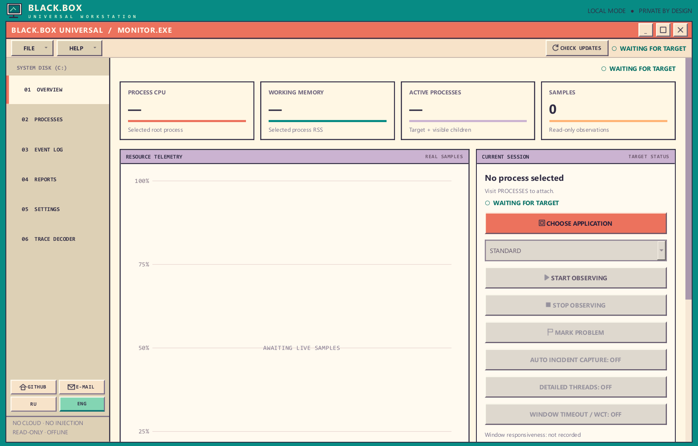

> If you found this program and it interests you, I would be very grateful if you reported any bugs you discover or suggested ways to improve it. Please send your message to **[DonJeoJesky@outlook.com](mailto:DonJeoJesky@outlook.com)**. I would truly appreciate it, because I don't have many people I know who might find this program useful (in fact, I don't have any). Even so, I hope you find in this program what you were looking for. Thank you simply for finding it.

# BLACK.BOX Universal

> **Antivirus / Windows SmartScreen notice:** Antivirus software or Microsoft Defender SmartScreen may warn about BLACK.BOX because its portable executable is unsigned and can inspect processes. **If the project interests you, you may add a narrowly scoped antivirus exception only after independently verifying and trusting the file.** Download from the [official repository Releases](https://github.com/jumonja-maker/BlackBox-Rep.-Alva-/releases), check the published ZIP SHA-256, and scan/review the download first. A warning is **not proof of a false positive**, and an exception reduces protection. Do **not** disable antivirus globally.

**A portable Windows workspace for recording a process, reviewing local evidence and running explicitly authorized diagnostics.**

[**Download published Windows x64 ZIP**](https://github.com/jumonja-maker/BlackBox-Rep.-Alva-/releases/latest) · [Expert workflow guide](docs/USER_GUIDE_EN.md) · [Русская версия](README.ru.md)

[](https://github.com/jumonja-maker/BlackBox-Rep.-Alva-/actions/workflows/shell-qa.yml)
  

**Source/development version: v0.6.0. Latest published release verified for this patch: v0.5.4.** The expert workflow changes and R10–R60 source features described here are development work; they do not mean that a v0.6.0 ZIP has been published. Downloads and the updater follow the [official GitHub Release](https://github.com/jumonja-maker/BlackBox-Rep.-Alva-/releases/latest). A source commit or green CI does not publish an update.

## Use a recording to answer a concrete question

| Task | Start with | Review and output |
| --- | --- | --- |
| Reproduce a slowdown, memory rise or I/O spike | Select the process; record the workload and mark the relevant moment | Timeline, recorded counters, gaps and source-linked findings; local SQLite/JSON/HTML |
| Compare two runs of the same workload | Keep target, capture profile, interval and workload conditions comparable | Session/action comparison with counts, variability and incompatible conditions |
| Examine a saved trace or crash capture | Open the existing ETL/EventPipe/JSONL in Trace Decoder, or use the relevant saved-source tool | Filtered events, supported stacks/symbols and explicit coverage; JSON/HTML exports |
| Check a diagnostic hypothesis against more evidence | Open Deep Inspection or Investigation Engine 3 inside Overview | Source links, partial critical paths, hypotheses and separately confirmed verification steps |

CPU, RSS, I/O, waits and temporal coincidence describe observations. They do not, by themselves, establish an application's internal root cause. Missing access, clocks, symbols and coverage remain explicit.

## Select → record → stop → review

1. **Select.** On **Processes**, search by name/PID, select the intended running instance and attach. Check its identity on **Overview**. PID plus creation time distinguishes an instance; selecting a file or browsing a recorded child does not start recording or rebind the live target.
2. **Record.** Choose **Standard**, **Detailed** or **Incident Burst** and check the sampling interval before **Start Observing**. Reproduce the workload. Add a problem mark or action boundaries when useful; these are user statements, not verified OS failures.
3. **Stop.** Use **Stop Observing** and check the save/finalization status. SQLite measurements and generated reports have distinct failure states; a report error does not establish that the recording was lost. Preserve the shown session folder and retry only the failed operation.
4. **Review.** In Overview, use **Open recording result** when the stopped recording is ready. This explicitly opens its saved evidence in **Reports**; Stop keeps your current page. Reports also opens other saved sessions. Check the session, process instance, interval and coverage before reading findings, then narrow the range, compare or export.

Reports keeps the loaded analysis folder/range visible and offers section navigation to the timeline, findings, library, capture actions and technical data. **Copy analysis context** puts the displayed context on the local clipboard; review it before sharing. **Ctrl+1…6** switches between the six pages; **Ctrl+L** opens Processes and focuses search.

For repeatable experiments, note the application version, workload and capture conditions alongside the recording. Ordinary observation does not request UAC. Profiles do not automatically start ETW, EventPipe or a dump.

[Detailed workflow and interpretation](docs/USER_GUIDE_EN.md) · [Russian guide](docs/USER_GUIDE_RU.md) · [Expert workflow patch scope (RU)](docs/EXPERT_WORKFLOW_PATCH_RU.md)

## Observation, inspection and intervention

| Scope | What it means |
| --- | --- |
| **OBSERVE** | Read-only operating-system counter collection for the selected accessible process. It does not modify target memory. |
| **INSPECT** | Explicit additional queries and captures in Deep Inspection. Access, supported sources and sensitive output depend on the operation; a dump can briefly pause a target. |
| **INTERVENE** | Explicit operations such as debugger actions, thread suspend/resume or selected memory writes. They require operation/target confirmation and applicable access; observation never starts them. |

The GUI remains unelevated. The source R10 administrator session uses a scoped, time-bounded Diagnostic Helper; each intervention retains its own consent and PID/creation-time check. Enabling rights is not blanket permission for later actions. Windows protection can still deny access. Unknown execution or cleanup stays unknown; rollback after a crash is not guaranteed. See [Deep Inspection](docs/BB_DEEP_001.md) and [R10 scope (RU)](docs/R10_RU.md).

## Six pages, one working context

| Page | Use it for |
| --- | --- |
| **Overview** | Live target identity, recording state, capture profile, telemetry and explicit advanced diagnostics inside the page |
| **Processes** | Search and attach a live instance; inspect an application file; browse recorded process/thread history |
| **Event Log** | Filter observation/lifecycle events and inspect original event references |
| **Reports** | Open current or saved recordings, select a time range, analyze, compare and export local evidence |
| **Settings** | Sampling and recording policy, recovery, updates and maintenance |
| **Trace Decoder** | Offline ETL, EventPipe `.nettrace` and BLACK.BOX JSONL analysis with explicit process/thread/time filters |

A saved recording, an imported trace, a live target and a diagnostic run are different sources. Opening history does not authorize a live action. The six primary pages and legacy five-page embedding API are retained.



*Historical Windows CI/offscreen capture, predating this expert workflow patch. It documents the earlier shell, not acceptance of the current layout. [Screenshot provenance](docs/screenshots/README.md).*

## Portable package and local evidence

Extract the **entire** published ZIP to a writable folder, then launch **`BLACK.BOX-Universal.exe`**. Keep `_internal` and all companion files. No separate Python installation, account, subscription or mandatory cloud service is required by the portable application.

| Packaged executable | Purpose |
| --- | --- |
| `BLACK.BOX-Universal.exe` | Main desktop application |
| `BLACK.BOX-Maintenance.exe` | Update/removal helper, normally launched by the application |
| `decoder/BLACK.BOX-Decoder.exe` | Bundled offline TraceEvent decoder with its runtime, launched when needed |

For an EXE file, BLACK.BOX reads metadata and can match a running instance by full executable path. Launching the selected EXE requires a separate confirmation. Other files provide metadata only; file selection never executes them. Local SHA-256 is calculated for files up to 16 MiB. File inspection is not malware scanning or static code analysis.

Default recording location:

```text
%USERPROFILE%\Documents\BLACK.BOX Universal\sessions\
└── <session-folder>\
    ├── session.sqlite3  # Measurements and lifecycle events
    ├── report.json      # Structured summary
    └── report.html      # Offline report
```

Additional captures and analyses have their own files and status. Share export creates a redacted copy; original recordings stay local. Memory/dumps and raw traces require separate inclusion. Known-field redaction cannot recognize every secret in free text: review exports before sharing. Checksums establish byte identity, not trusted authorship. No observations are uploaded automatically.

**Check Updates** uses published GitHub Releases, verifies the downloaded ZIP size/SHA-256 and uses Maintenance after the application closes. Startup update checking is enabled by default and can be disabled in Settings. Sessions under Documents are intended to survive updates/removal. [Updates, feedback and removal](docs/UPDATES_FEEDBACK_UNINSTALL.md).

## Advanced reference and history

Use these after choosing the evidence needed for the question:

- [Deep Inspection: operations and boundaries](docs/BB_DEEP_001.md) · [Investigation Engine 3: evidence graph and manual verification](docs/BB_INV_003_EN.md)
- [Trace Decoder completion and limits](docs/TRACE_DECODER_COMPLETION_PATCH.md) · [Native CPU/filter contract](docs/TRACE_DECODER_PHASE5_PACKET2.md) · [Module/PDB contract](docs/TRACE_DECODER_PHASE5_PATCH.md)
- [R10 administrator session (RU)](docs/R10_RU.md) · [R20 provenance](docs/BB_WAVE_02_R20_RU.md) · [R30 waits/I/O](docs/BB_WAVE_02_R30_RU.md) · [R40 crash evidence](docs/BB_WAVE_02_R40_RU.md) · [R50 incidents/comparison](docs/R50_RU.md) · [R60 Chain Builder](docs/R60_CHAIN_BUILDER_RU.md). R10–R60 here describe source/development features beyond the published v0.5.4 package.
- [Voluntary application instrumentation / SDK](docs/SDK_GUIDE.md): add examples to your own source and rebuild; external observation alone does not expose internal application stages.
- Published-release history: [v0.5.4](docs/RELEASE_v0.5.4.md), [v0.5.3](docs/RELEASE_v0.5.3.md), [v0.5.2](docs/RELEASE_v0.5.2.md), [v0.5.1](docs/RELEASE_v0.5.1.md), [v0.5.0](docs/RELEASE_v0.5.0.md). [v0.5.5](docs/RELEASE_v0.5.5.md) and [v0.6.0](docs/RELEASE_v0.6.0.md) documents are candidate/development notes, not evidence of publication.
- [Architecture](docs/ARCHITECTURE.md) · [Product scope](docs/PRODUCT_SCOPE.md) · [QA evidence](docs/QA_EVIDENCE.md) · [Release gates](docs/RELEASE_GATES.md) · [Historical implementation checklist](docs/BB_DI_001_IMPLEMENTATION_STATUS.md)

Offline session investigation identifies suspicious recorded intervals and writes separate JSON/HTML. It does not itself collect missing ETW/stacks. Investigation Engine 3 correlates supported saved sources; `BLOCKED` is not proof of lock ownership and hypotheses remain testable proposals. Trace sample counts are not CPU%; GC elapsed time is not a stop-the-world pause. Imported data remains unverified; trace/session clock alignment must be established for the actual inputs.

Hosted Windows/Linux, native and portable checks cover their recorded scenarios and exact source commits. They do not establish physical Windows 10/11 acceptance, interactive Secure Desktop UAC, assistive-technology acceptance, antivirus reputation or universal long-run reliability. Historical PR #17 and its 128-requirement checklist describe an earlier milestone, not the current patch's acceptance status. Use exact-commit CI evidence and the relevant patch report for current results. Binaries are unsigned; bundled license notices do not constitute a complete legal redistribution audit.

## Development and CLI

The source uses Python 3.11+, PySide6/Qt, psutil, SQLite and `blackbox_core`. Follow [AGENTS.md](AGENTS.md) for this patch: application/test/build execution is restricted to GitHub-hosted runners; local source review and edits are allowed. The portable ZIP is the normal desktop distribution.

The optional CLI supports `list`, `record`, `summary`, `compare` and `export`. The `record --output` directory must already exist:

```powershell
python -m blackbox_core list
python -m blackbox_core record --pid 1234 --output .\sessions --duration 10 --interval 1
python -m blackbox_core summary .\sessions\<session-folder>
python -m blackbox_core compare .\sessions\<first-folder> .\sessions\<second-folder>
```

## License and feedback

Original source: [MIT](LICENSE). Packaged dependencies retain their own terms; see [Licensing](docs/LICENSING.md).

[Open an issue](https://github.com/jumonja-maker/BlackBox-Rep.-Alva-/issues) or write to **[DonJeoJesky@outlook.com](mailto:DonJeoJesky@outlook.com)** with BLACK.BOX version, Windows version and reproduction steps. Include only non-sensitive report excerpts.
