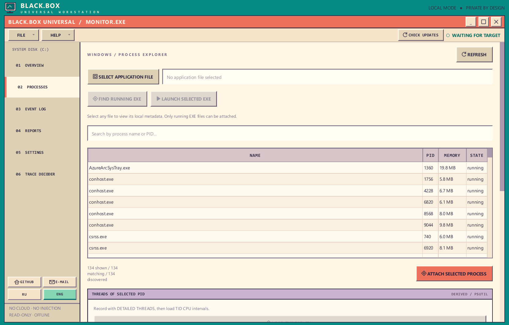
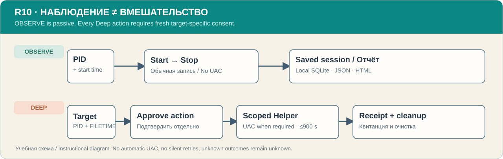
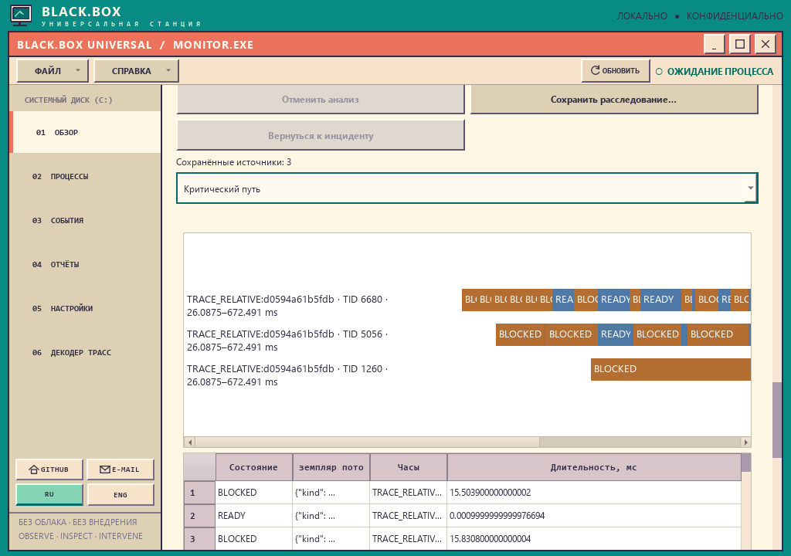
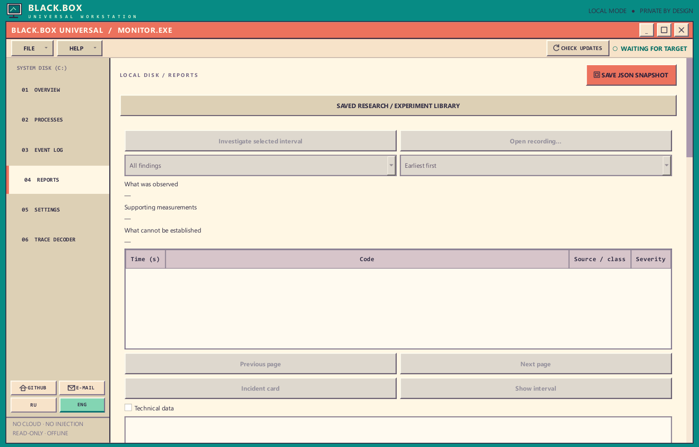
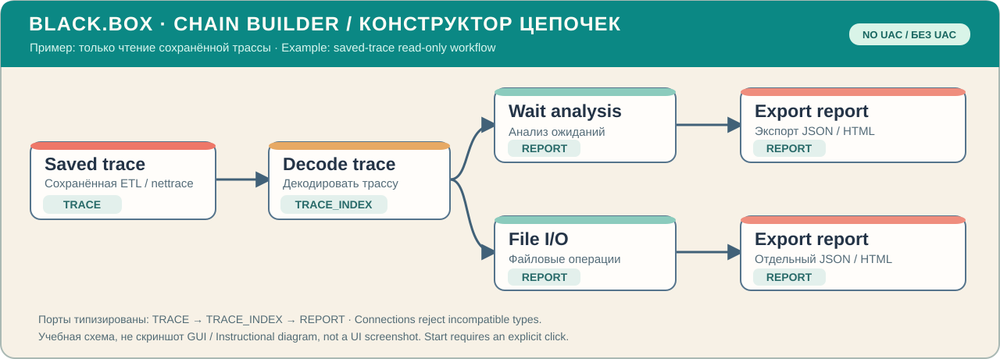
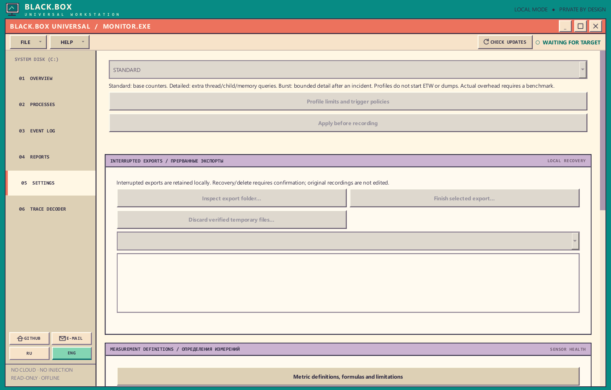
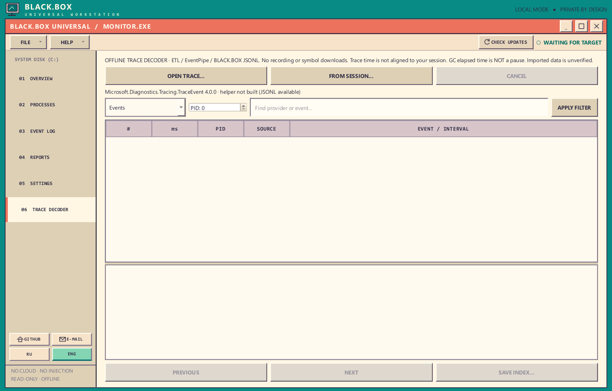
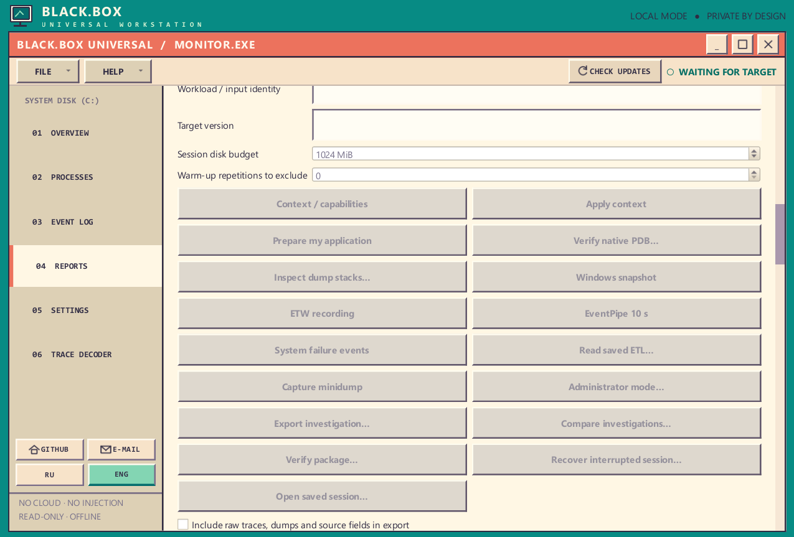

> If you found this program and it interests you, I would be very grateful if you reported any bugs you discover or suggested ways to improve it. Please send your message to **[DonJeoJesky@outlook.com](mailto:DonJeoJesky@outlook.com)**. I would truly appreciate it, because I don't have many people I know who might find this program useful (in fact, I don't have any). Even so, I hope you find in this program what you were looking for. Thank you simply for finding it.

# BLACK.BOX Universal

> **Antivirus / Windows SmartScreen notice:** Antivirus software or Microsoft Defender SmartScreen may warn about BLACK.BOX because its portable executable is unsigned and can inspect processes. **If the project interests you, you may add a narrowly scoped antivirus exception only after independently verifying and trusting the file.** Download from the [official repository Releases](https://github.com/jumonja-maker/BlackBox-Rep.-Alva-/releases), check the published ZIP SHA-256, and scan/review the download first. A warning is **not proof of a false positive**, and an exception reduces protection. Do **not** disable antivirus globally.

**A portable Windows tool for process observation, deep inspection and controlled diagnostic actions.**

[**Download latest published Windows x64 release**](https://github.com/jumonja-maker/BlackBox-Rep.-Alva-/releases/latest) · [Releases](https://github.com/jumonja-maker/BlackBox-Rep.-Alva-/releases) · [Русская версия](README.ru.md)

[](https://github.com/jumonja-maker/BlackBox-Rep.-Alva-/actions/workflows/shell-qa.yml)
  

**Source version: v0.6.0 (current development tree).** The [official GitHub Release](https://github.com/jumonja-maker/BlackBox-Rep.-Alva-/releases/latest) alone determines which Windows build can actually be downloaded and updated. Until a matching public Release exists, its packaged features may be older than the README. Passing CI does not publish an update.

**R60 — Chain Builder (integrated in the current source):** Overview has an optional Chain Builder workspace for typed, bounded workflows using the existing diagnostic tools. Opening a graph or preview is passive; protected actions still require fresh R10 consent and truthful cleanup receipts. Six primary pages and the five-page embedding interface are preserved. The source feature does not become a public update until a new GitHub Release is published. [Visual tutorials below](#learn-the-new-r10r60-features-visual-walkthrough) · [Full R60 guide (RU)](docs/R60_CHAIN_BUILDER_RU.md).

**R10 — one time-limited administrator session (integrated in the current source):** The top toolbar offers **Enable administrator rights** for the existing scoped Diagnostic Helper (up to 900 seconds). Separate process-instance verification (PID + creation FILETIME), action-specific consent, cleanup and execution receipts remain mandatory. Normal OBSERVE never requests UAC, and physical Secure Desktop UAC is NOT_TESTED. [Visual tutorial below](#lesson-1-r10--use-administrator-rights-only-when-needed) · [R10 guide (RU)](docs/R10_RU.md) · [Cumulative release scope](docs/RELEASE_v0.6.0.md).

BLACK.BOX Universal lets you **select a running process or choose an application file**. OBSERVE records operating-system measurements and saves local SQLite, JSON and HTML sessions without changing the target. File selection itself only reads metadata. In the separate BB-DEEP-001 patch, explicit INSPECT and INTERVENE actions can snapshot, pause, debug and modify selected memory after confirmation. They are not started by ordinary sampling. The portable application requires no service, account, cloud server, subscription or separately installed Python.

> **Important:** BLACK.BOX provides observational evidence, not proof of an application's internal root cause. High CPU, rising memory, or a process exiting do not, on their own, establish why it failed.

**Investigation Engine 3 — v0.5.4:** Overview → Deep Inspection → **INVESTIGATE PROBLEM** links saved evidence, partial wait paths and testable hypotheses. BEFORE/ACTION/AFTER steps require individual user confirmation. Incomplete identity, clocks and coverage remain explicit. [Guide](docs/BB_INV_003_EN.md) · [Русская инструкция](docs/BB_INV_003_RU.md) · [Specification](docs/specifications/BB-INV-003.md). [Visual step-by-step walkthrough](#investigation-engine-3-v054-visual-walkthrough).

**BB-DEEP-001 — available since v0.5.3:** The expandable **Deep Inspection** block stays inside Overview and provides Processes, Modules, Threads, Handles, Memory, Network, Disk, Debug and Timeline panels. Operation-specific access checks can offer a standard Windows UAC prompt for a scoped diagnostic helper; the GUI remains unelevated. Sensitive memory and dumps are excluded from ordinary sharing. Historical trace instance IDs are not silently equated with current process creation times. See the [English guide and supported boundaries](docs/BB_DEEP_001.md), [Russian guide](docs/BB_DEEP_001_RU.md) and [original specification](docs/specifications/BB-DEEP-001.md). The v0.5.3 release was verified on exact-SHA GitHub-hosted CI.

**BB-DEEP-001 — released in v0.5.3:** Deep process inspection, controlled debugger/memory actions and scoped Diagnostic Helper within Overview. [v0.5.3 release notes](docs/RELEASE_v0.5.3.md).

**Decoder completion in v0.5.2 source:** Offline trace/session clock correlation (with explicit uncertainty), ETW off-CPU/ready-delay analysis, native PDB source lines/inline sites/OMAP and bounded import recovery. Clock evidence is not trace authentication, scheduler events do not prove a lock owner, and unsupported symbols remain unknown. See [completion scope and acceptance limits](docs/TRACE_DECODER_COMPLETION_PATCH.md) and [v0.5.2 release notes](docs/RELEASE_v0.5.2.md). The installed version is determined only by the published GitHub Release, not a source commit.

**v0.5.0 Trace Decoder:** The sixth page imports ETL, EventPipe and BLACK.BOX JSONL offline using the bundled self-contained Microsoft TraceEvent helper. It provides events, GC intervals, capture-clock evidence, module observations, local native PE/PDB checks and derived symbol names, and separate .NET/native ETW CPU sample trees. Select PID, process instance, thread and the time interval explicitly; export JSON or script-free HTML/SVG flame views. The decoder does not record automatically or download symbols. Counts are not CPU%, GC elapsed is not a pause, and trace/session clock alignment remains **NOT_ESTABLISHED**. See [release scope and limits](docs/RELEASE_v0.5.0.md), [module/PDB contract](docs/TRACE_DECODER_PHASE5_PATCH.md) and [native CPU/filter contract](docs/TRACE_DECODER_PHASE5_PACKET2.md). Publication is gated on the exact commit's Windows/Linux/portable and real trace acceptance; a source branch is not itself a published update.

**v0.4.2 desktop:** The turquoise banner and monitor icon are compact, the decorative sparkle row is gone, and the FILE/HELP toolbar uses less height. The chart, Current Session and other pages begin higher on screen; normal Windows window controls remain. CI measures the actual workspace start at full and minimum window sizes in RU/EN, with Windows offscreen DPI captures at 100–200%. This is layout-only: evidence collection and recording behavior are unchanged.

**v0.4.1 desktop:** The window starts maximized but can be restored or resized. The decorative START footer and redundant VIEW menu are removed; the telemetry chart uses the available vertical area. Privacy/security details remain in this README rather than occupying space in Settings.

**v0.5.1 audit corrections:** independent recording/index failure handling, copy-only share privacy, Stop/retry lifecycle, complete findings and explicit notes, CSV and Unicode profile search fixes. Includes the reviewed PR #25 fixes and additional embedded-path/schema regressions. [Release details and limits](docs/RELEASE_v0.5.1.md). Source code is not a published update until the release gate completes.

## What BLACK.BOX looks like


*Overview — actual Windows CI/offscreen screenshot of the earlier `main` development build. The dashboard is waiting for a target; no measurement is fabricated. The older v0.4.2 release lacks the decoder; v0.5.0 adds it. These screenshots predate the complete v0.5.0 decoder controls.*

## Download and first run

1. Download the [latest Windows ZIP](https://github.com/jumonja-maker/BlackBox-Rep.-Alva-/releases/latest) and **extract it completely** to a writable directory.
2. Double-click **`BLACK.BOX-Universal.exe`**.
3. Open **Processes**. Either select a running application from the list and click **Attach**, or click **Select Application File** to choose an EXE (or another file).
4. If you chose an EXE, click **Find Running EXE** to attach to an already running instance, or **Launch Selected EXE** and explicitly approve starting the file. Then go to **Overview**, click **Start**, interact with the application, and click **Stop**.
5. In **Reports**, examine the recorded data, open the saved HTML, export a snapshot, or compare two sessions.

### Select and attach a process



*Processes — search by process name or PID, or choose an EXE file. Attaching does not start recording; use **Start** in Overview when you are ready.*

**Which EXE files are included in v0.5.0?**

| File | Purpose |
| --- | --- |
| `BLACK.BOX-Universal.exe` | Main application. **Launch this one.** |
| `BLACK.BOX-Maintenance.exe` | Helps update or remove the portable application after the main EXE closes. Usually runs automatically. |
| `decoder/BLACK.BOX-Decoder.exe` | Optional offline ETW/EventPipe decoder, packaged with its own .NET runtime. The app launches it when needed; **do not launch manually**. Included from v0.5.0; not part of the older v0.4.2 ZIP. |

Keep the entire `_internal` folder and the other extracted files. The main EXE is **not** a standalone file you can copy out of the portable folder.


## Learn the new R10–R60 features: visual walkthrough

**Who this is for:** start with a normal observation from **Processes → Overview → Reports** (above), then pick a diagnostic path. The examples do not modify another application without explicit consent.

> **Version matters.** The features below are in the current **0.6.0 source tree** on `main`. A green CI run is **not** an official Windows download; the latest [published GitHub Release](https://github.com/jumonja-maker/BlackBox-Rep.-Alva-/releases/latest) may still contain an earlier version. The new SVG pictures are **instructional diagrams**, not screenshots. Embedded PNGs are genuine Windows Qt/offscreen captures, some from earlier builds, and never evidence from your own computer.

| Your question | Where to start |
| --- | --- |
| What is my process doing? | **Processes → Overview → Start / Stop → Reports** |
| Do I need privileged inspection? | **Overview → Deep Inspection** (R10) |
| Where did this finding come from? | **Investigation → Sources and cleanup** (R20) |
| Why was a thread waiting or using I/O? | **Trace Decoder → Investigation → Critical Path** (R30) |
| What does a saved crash dump tell me? | **Investigation → Add saved minidump** (R40) |
| Did behavior change between two runs? | **Reports + Settings** (R50) |
| Can I combine existing tools safely? | **Overview → Chain Builder** (R60) |

### Lesson 1. R10 — use administrator rights only when needed



1. Ordinary **CPU, memory and recording** do not need UAC. Select a running process, **Start**, then **Stop**.
2. For a more privileged operation, expand **Overview → Deep Inspection**. If the operation requires elevation, choose **Enable administrator rights** in the top toolbar and approve Windows UAC *if prompted*.
3. The verified Diagnostic Helper lease is limited to **900 seconds**. Each process instance is checked by **PID + creation FILETIME**, and each consequential action needs a **new, separate confirmation**. A prior UAC prompt is not standing permission.
4. End the session and inspect the real receipt. `CLEANUP_REQUIRED` or `RECOVERY_UNCONFIRMED` must not be treated as successful cleanup. Never silently retry an unknown intervention.

Elevation does not bypass Windows protected-process restrictions. [Detailed R10 guide (RU)](docs/R10_RU.md).

### Lesson 2. R20 — inspect evidence provenance and cleanup

1. Open **Overview → Deep Inspection → INVESTIGATE PROBLEM** and add a **saved** session, decoder index, journal or dump metadata.
2. Build the graph and open **Sources and cleanup**. Read each source type, SHA-256, coverage and the actual execution/cleanup receipt.
3. Export to JSON/HTML and read the saved result back without overwriting the original input.

A matching SHA-256 proves **byte identity, not authorship**. Imported data remains `UNVERIFIED_IMPORT` or partial where appropriate. [R20 reference (RU)](docs/BB_WAVE_02_R20_RU.md).

### Lesson 3. R30 — trace waits, ready time and I/O



1. If you have a real **ETL or EventPipe** file, import it through **Trace Decoder**, then choose the saved index and the relevant process/time range.
2. Open the evidence in Investigation Engine 3 and inspect **Critical Path**, available wait intervals, FileIO and DiskIO.
3. Compare actual `RUNNING`, `BLOCKED`, `READY` and `UNKNOWN` intervals and check the evidence/source coverage.

A blocked thread does not identify a lock owner by itself. Disk I/O observations may not contain actual service time. [R30 reference (RU)](docs/BB_WAVE_02_R30_RU.md).

### Lesson 4. R40 — investigate an already saved crash

1. Add an **existing minidump**, or supported Windows Event Log/WER evidence, to Investigation.
2. Inspect saved crash context and AMD64 stacks. Local PE/PDB symbols must match the recorded module.
3. Read the explicit limitations: absent symbols, incomplete context and unknown live-process identity. Do not attach dump/memory bytes to a routine share export.

Opening a saved dump is not the same as creating a new one. A new dump requires permission, an eligible target and separate consent. [R40 reference (RU)](docs/BB_WAVE_02_R40_RU.md).

### Lesson 5. R50 — compare before and after, and review incidents



1. In **Reports**, set a scenario, scenario version and comparable workload **before recording**.
2. In **Settings**, choose **Standard**, **Detailed** or **Incident Burst**, suitable triggers and bounded prehistory. Selecting a profile does not silently enable ETW, dumps or interventions.
3. Record run A using **Start → repeatable application action → Stop**. Repeat with the same workload after a change.
4. In Reports, select **Compare investigations**, inspect the reasons for comparability, **Save comparison JSON / HTML**, and reopen the saved result if needed.

`COMPARABLE` means the **recorded conditions** can be compared; it does not prove improvement. `NOT_COMPARABLE` and `INCONCLUSIVE` must not be rewritten as a win. [R50 reference (RU)](docs/R50_RU.md).

### Lesson 6. R60 — build a typed diagnostic chain



*This is a teaching diagram, not an actual program screenshot.*

1. Open **Overview → Chain Builder**. Set a name and choose a profile for **Windows**, a **selected application** or a **specific investigation**. A profile alone never selects arbitrary targets.
2. Start with an **existing ETL/EventPipe trace**: add `load_source` with type `TRACE`, add `decode_trace`, and connect `source → trace`.
3. Connect the `TRACE_INDEX` output to `waits` and/or `file_io`. Send each resulting `REPORT` to its own `export_report`. Incompatible port types are rejected; a saved OBSERVE `SESSION` is **not** a `TRACE`.
4. Click **Check / preview** and inspect the effective profile, missing inputs, privileges, limits and declared resource ownership. Preview is **passive**.
5. Choose **Start** deliberately. Live targets or Deep tools still require fresh process identity and separate R10 consent. Use **Pause**, **Continue** and **Stop chain** with their actual completion/cleanup statuses.
6. Save a new `*.bbchain.json` definition and `*.bbprofile.json` profile; inspect run history and JSON/HTML exports in **Reports**. Opening history never resumes work automatically.

**Canvas tips:** drag nodes with the mouse; pan via the middle button or **Space + left drag**; scroll to zoom; **Fit graph** restores the view. `CONDITION`, `JOIN` and bounded `REPEAT` are typed controls, not arbitrary Python/scripts. Repeats are limited to read-only work, and partial branch input must be explicitly allowed. [Full R60 Chain Builder guide (RU)](docs/R60_CHAIN_BUILDER_RU.md).

### What the result statuses mean

| Status | Actual meaning |
| --- | --- |
| `COMPLETED` | The declared operation completed; root cause is **not** proven. |
| `PARTIAL` / `INCOMPLETE` | Only some requested evidence or results were available. |
| `UNKNOWN` / `NOT_ESTABLISHED` | The sources do not establish that claim. |
| `RECOVERY_UNCONFIRMED` / `CLEANUP_REQUIRED` | Resumption or owned cleanup is unconfirmed; consequential work is not silently retried. |

**Privacy:** ETW traces may capture other processes; dumps and memory can contain secrets. Review files before sharing. GitHub-hosted Windows acceptance is not a physical Windows 10/11 or interactive UAC Secure Desktop test.


## What is included?

| Tab | Capabilities |
| --- | --- |
| **Overview** | CPU/RSS metrics, graphs, Start/Stop and live target identity. The BB-DEEP-001 patch adds a collapsed Deep Inspection block with explicit diagnostic actions. |
| **Processes** | Select by name/PID **or choose an application file**. Match a running EXE by its full path, or launch a selected EXE only after explicit confirmation. |
| **Event Log** | Local observation messages; session start/stop events are persisted in SQLite. |
| **Reports** | Current snapshot, `report.json`, readable offline `report.html`, manual export and session comparison. |
| **Settings** | RU/EN interface, 1/2/5-second sampling intervals, update checks, desktop shortcut, feedback and removal. |
| **Trace Decoder — included since v0.5.0** | Offline ETL/EventPipe/JSONL reading with separate CPU sample stacks and GC intervals. Included in the published v0.5.1 release; v0.4.2 predates this page. |

### Settings — capture profiles and recovery controls



*Settings — select a capture profile **before recording**. Standard provides base counters, Detailed adds bounded thread/child/memory queries, and Burst adds incident-triggered detail. Disabled actions require an applicable target or state. Scroll down for export recovery and measurement definitions. Language switching (RU / ENG) is in the left sidebar; **Check Updates** is in the top toolbar. Choosing a profile does not automatically capture ETW or dumps.*

### Reports and saved observations


*Reports — inspect or export local evidence after a session; incomplete or inaccessible measurements are not silently reported as zero.*

### Development-only trace analysis



*Trace Decoder (published since v0.5.0, retained in v0.5.1) — import an ETL, EventPipe `.nettrace`, or BLACK.BOX JSONL file offline. CPU profiler samples, event-associated stacks and GC intervals have distinct meanings. Older v0.4.2 packages do not contain this tab.*

Some counters are inaccessible for protected processes or unavailable on a particular system. Missing values are displayed as **unknown**, not misleading zeros. RSS describes the selected process; it is **not** the summed memory usage of a complete process tree.

### What happens when I select a file?

- **EXE:** BLACK.BOX reads file metadata and PE architecture, and can find a currently running instance **by exact executable path**, not a guessed filename. You can also choose to start the EXE yourself; starting it from BLACK.BOX requires a separate confirmation.
- **DLL, SYS, MSI, COM, BAT, CMD, PS1, PY, JAR, and other files:** display **read-only metadata** (type, size, modification time and, where possible, PE architecture). These are not stand-alone running processes and BLACK.BOX does not silently run them.
- A SHA-256 checksum is calculated **locally** for files up to 16 MiB; larger files are not hashed in the GUI. Choosing or inspecting any file never executes it.

**File inspection is not malware scanning, static code analysis, or active application debugging.** Live CPU/RSS/I/O monitoring requires a running, accessible process.

### Where does my data go?

By default, each recording is saved under:

```text
%USERPROFILE%\Documents\BLACK.BOX Universal\sessions\
└── <session-folder>\
    ├── session.sqlite3  # Measurements and lifecycle events
    ├── report.json      # Structured summary
    └── report.html      # Human-readable offline report
```

Reports can be viewed and compared without an internet connection. No process observations are uploaded automatically. **Review recorded data before sharing it**, since names and timestamps can reveal private activity.

## Updates and privacy

**Check Updates** compares the current version with the latest published [GitHub Release](https://github.com/jumonja-maker/BlackBox-Rep.-Alva-/releases). A commit pushed to `main` is **not** an update until a new version is released. If an update is available, confirm the download and installation; BLACK.BOX verifies the ZIP's size and SHA-256 and uses the Maintenance helper to replace the application after it closes.

Checking GitHub for updates at startup is **enabled by default** and can be switched off in **Settings**. Other than this check and links you deliberately open, monitoring and reports are local. Session folders under Documents are intended to survive updates and application removal.

See [Updates and maintenance](docs/UPDATES_FEEDBACK_UNINSTALL.md).

## Reliability and visual hardening in v0.3.6

- Race-safe report publication refuses overwriting existing `report.json` or `report.html` even when another writer races the check; preserves originals on failure.
- Only true observation warnings/errors appear in error summaries. User problem markers are no longer counted as errors; SQLite events are read incrementally.
- Stronger release ZIP validation rejects reserved Windows names, malformed paths, special nodes, Unicode/case aliases, collisions and preexisting staging roots.
- The portable updater and uninstaller reject Windows junction/reparse points, including ancestor folders; unreadable path metadata fails closed. Updates preserve user sessions or revert a failed replacement when possible.
- CPU plots rescale for multicore processes above 100% without clipping observed peaks.
- Automated RU/EN Qt offscreen screenshots at 100/125/150/200% scaling supplement, but do not replace, manual physical Windows DPI and update/rollback checks.

[Independent review and remaining acceptance limitations](docs/DEEP_HARDENING_REVIEW.md).


## Investigation Engine 3 (v0.5.4): visual walkthrough


*Authentic **Russian-language** Qt screenshot captured during [BB-INV-003 Windows CI](https://github.com/jumonja-maker/BlackBox-Rep.-Alva-/actions/runs/41085704991), source commit `41d50627` (1024 × 720). The workspace is scrolled to **Critical Path**, not showing all seven sections at once. Orange **BLOCKED** marks an observed wait interval; blue **READY** marks a ready-to-run thread. Neither proves lock ownership or root cause. This is not an AI mockup or a measurement from your application.*

**Quick start:** **Overview → Deep Inspection → INVESTIGATE PROBLEM → add recorded sources → Build evidence graph → inspect links and hypotheses → optionally verify manually → export**.

### Step 1. Open the workspace and select evidence

1. Open **Overview**, expand **Deep Inspection**, then choose **INVESTIGATE PROBLEM**. This is a workspace *within Overview*, not a seventh main page. Opening it does not record, debug, or request UAC.
2. Add one or more **previously recorded** sources: a BLACK.BOX session folder, Trace Decoder SQLite index, Deep Inspection journal, Investigation Engine 2 JSON, recorded JSONL events, or saved minidump metadata. For raw **ETL** or **EventPipe**, first import through **Trace Decoder**, then select the resulting index.
3. Select **Build evidence graph**. Wait for the result and examine its source list, coverage, truncation warnings and missing evidence. Original input files are not overwritten.

### Step 2. Read the seven internal sections

| Section | What to inspect |
| --- | --- |
| **Problem overview** | Sources, incident context, coverage and limits. |
| **Related observations** | Original events and recorded references supporting a claim. |
| **Evidence graph** | Nodes and classified links such as `DIRECT_REFERENCE`, `TEMPORAL_COINCIDENCE` or `NOT_ESTABLISHED`. |
| **Critical path** | Thread intervals: `RUNNING`, `BLOCKED`, `READY`, plus `UNKNOWN` / `INCOMPLETE` gaps. |
| **Hypotheses** | Supporting and contradicting facts, alternatives, missing measurements and proposed next checks. |
| **Verification** | A newly confirmed live target, BEFORE/AFTER snapshots and separately authorized diagnostic actions. |
| **Recurrences** | Related cases, declared application/workload context and compatible capture comparisons. |

**Interpreting the screenshot:** a shared timestamp, PID or image name does not establish a relation. `BLOCKED` does not identify a lock owner; `READY` alone does not explain why a thread has not run. If source identity, clock evidence or stack links are missing, the engine displays an explicit gap. Select a row to inspect its original reference; navigation to threads, stacks, modules or the decoder requires a recorded link.

### Step 3. Manually test a hypothesis

1. In **Hypotheses**, read the selected proposal's **supporting, contradicting and missing evidence**. It is not a proven root cause.
2. In **Verification**, explicitly select and confirm a **current live process for new measurements**; this does not relabel historical observations.
3. Select **Capture BEFORE** and wait for its snapshot ID.
4. If intervention is necessary, choose an existing **manual Deep action**, review rights, impact, timeout, recovery and cleanup, then provide the **explicit parameters** and select **Confirm chosen action**. Only the scoped Diagnostic Helper may request UAC; declining does not discard saved evidence.
5. Select **Capture AFTER**, then **Compare BEFORE / AFTER**. An observed difference does not by itself prove a fix; a causal conclusion can remain `INCONCLUSIVE`.

**Important:** this feature is not an automatic workflow builder. Changing targets invalidates prior consent; a failed step ends that experiment. On `RECOVERY_UNCONFIRMED`, inspect the outcome and existing Deep Inspection cleanup before attempting anything else.

### Step 4. Save, revisit and compare

- Select **Export investigation** and choose a **new JSON or standalone HTML filename**. Both are local and readable without internet; source sessions and trace files remain separate.
- Use **Recurrences** only for sufficiently comparable captures. If needed, select **Declare application / workload context**, and separately choose the application binary for its locally computed SHA-256. User-entered version/workload metadata remains user-reported rather than OS-attested.
- Review any personally entered text before sharing an export. **Export does not upload** evidence to a cloud service.
- Large investigations can be deliberately partial. Paging the GUI does **not** automatically continue reading the complete original trace.

**Example:** when an application intermittently stops responding, add the saved session and an ETW-derived index, inspect **Critical path**, examine recorded waits and supported thread references, then review a **UI_UNRESPONSIVE** hypothesis. Preserve uncertainty when links are missing; use new manual snapshots only if you need further evidence.

[Complete technical/user guide](docs/BB_INV_003_EN.md) · [Русская инструкция](docs/BB_INV_003_RU.md) · [Specification](docs/specifications/BB-INV-003.md)

## Investigation Engine 0.1.2



*Expanded research controls in the current `main` build (not all available in the published version). Greyed-out actions need a suitable target, permission or recording state; advanced sources such as ETW/EventPipe are **explicit opt-in**, not automatic.*

- While recording, click **Mark Problem** (after at least one sample) to save a timestamp and an optional note. This is an explicitly **unverified user mark**, never OS-attested evidence of a hang.
- Stop recording. In **Reports**, click **Investigate Session** to analyze the just-completed recording or **Investigate Saved** for another local session.
- Review the new bilingual findings table and click an entry to view the measured facts and their limitations. The **Event Log** shows a separate findings table.
- Open the independent offline Investigation HTML report. The engine creates new uniquely named JSON/HTML files and does **not overwrite** the original SQLite, JSON or HTML reports.

This offline analysis uses recorded CPU, RSS, I/O and other available counters to identify suspicious *intervals*, not proven root causes. It does **not** perform ETW, wait-chain tracing, stack inspection or native hang detection. Sessions over 4096 samples require explicit approval for an analysis of just the latest 4096 samples and always disclose incomplete coverage. [Investigation Engine license](docs/vendor/investigation-0.1.2-LICENSE).

## Scope and current quality status

BLACK.BOX is **not** a PC cleaner, antivirus or automatic repair utility. The BB-DEEP-001 patch adds Windows Debug API actions and a bounded local minidump metadata/memory reader; it does not claim complete dump unwinding, managed-heap analysis, protection bypass or guaranteed rollback after a crash. Access is decided by Windows. OS counters, wait reasons and successful diagnostic actions do not by themselves prove an application's internal fault.

**Baseline QA for v0.3.2:** [GitHub Actions run #39872624116](https://github.com/jumonja-maker/BlackBox-Rep.-Alva-/actions/runs/39872624116) passed **new file-selection and existing process tests on Windows and Linux**, built the Windows executable, and passed frozen-EXE startup/smoke checks for commit [`6c8d9478`](https://github.com/jumonja-maker/BlackBox-Rep.-Alva-/commit/6c8d94785492e4373a80720b7812871b94856241). The newer v0.3.6 source, PE file picker, and packaged executable are subject to [current main CI](https://github.com/jumonja-maker/BlackBox-Rep.-Alva-/actions?query=branch%3Amain). Manual clean-Windows, update/rollback, antivirus and code-signing acceptance are **not established by these tests**. Distributed EXEs are currently unsigned; third-party package license notices also require final review.

## Developing from source

The project is Python-first: **Python 3.11+**, PySide6/Qt, psutil, SQLite, and the standalone `blackbox_core` package. Developers need Python; users of the portable ZIP do not.

```powershell
py -3.11 -m venv .venv
.\.venv\Scripts\Activate.ps1
python -m pip install -r requirements.txt
python -m pip install -e .
python app.py
```

For BB-DEEP-001, all automated tests, native controlled workloads, portable-EXE checks and the endurance job run exclusively on GitHub-hosted runners. Follow the [patch validation guide](docs/BB_DEEP_001.md); no mandatory acceptance test is to run on a user's computer. A hosted job does not establish real interactive UAC Secure Desktop behavior or physical Windows 10/11 acceptance.

An optional CLI is available for advanced users. The `record --output` directory must already exist:

```powershell
python -m blackbox_core list
python -m blackbox_core record --pid 1234 --output .\sessions --duration 10 --interval 1
python -m blackbox_core summary .\sessions\<session-folder>
python -m blackbox_core compare .\sessions\<first-folder> .\sessions\<second-folder>
```

It also supports `export`. The desktop GUI is the normal user interface.

### Project layout

```text
app.py                       GUI entry point and smoke test
blackbox_universal/          Qt shell, file picker, observer, updates, maintenance
src/blackbox_core/           Read-only process sampling, SQLite, reports, CLI
tests/                      Automated tests
tools/                      Windows icon creation and EXE resource verification
.github/workflows/           Windows/Linux CI and portable release packaging
docs/                       Architecture, contracts and release requirements
```

See [Architecture](docs/ARCHITECTURE.md), [Product scope](docs/PRODUCT_SCOPE.md), [QA evidence](docs/QA_EVIDENCE.md), and [Release gates](docs/RELEASE_GATES.md).

## License and feedback

The original source is available under [MIT](LICENSE). Packaged dependencies, including Qt/PySide6 and Python, retain their respective licenses; see [Licensing](docs/LICENSING.md).

To report a problem, [open an issue](https://github.com/jumonja-maker/BlackBox-Rep.-Alva-/issues) with your BLACK.BOX version, Windows version, reproduction steps, and only **non-sensitive** report excerpts. You can also send feedback to **[DonJeoJesky@outlook.com](mailto:DonJeoJesky@outlook.com)**. Please do not include sensitive data from diagnostic reports.

### Integrated diagnostics and scope

BLACK.BOX includes Standard, Detailed and incident-burst observations, persisted process/thread histories, local interval analysis and optional native Windows/WCT, ETW, EventPipe and minidump sources. Additional capture is explicitly controlled; recorded counters do not prove an internal root cause. Session files and local evidence are not uploaded automatically.

The v0.4.1 patch refines desktop layout only: it does **not** add an automatic detective, new system collectors or higher sampling overhead. Physical Windows 10/11, assistive technology, antivirus/OneDrive and the full 128-point diagnostic acceptance remain separate validations. See [implementation status](docs/BB_DI_001_IMPLEMENTATION_STATUS.md) and [research scope](docs/RESEARCH_PRODUCT_IMPLEMENTATION.md).
