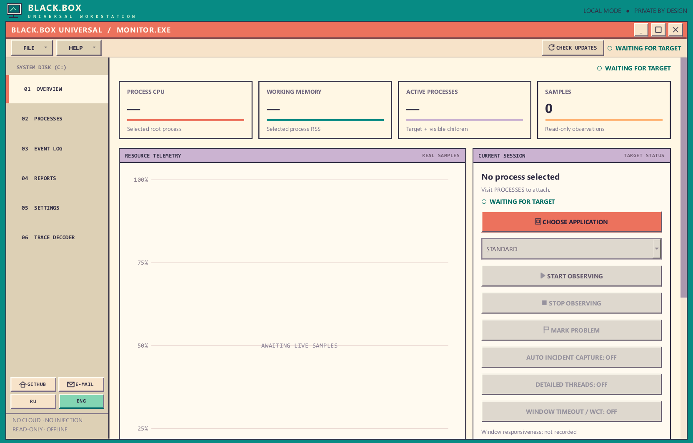
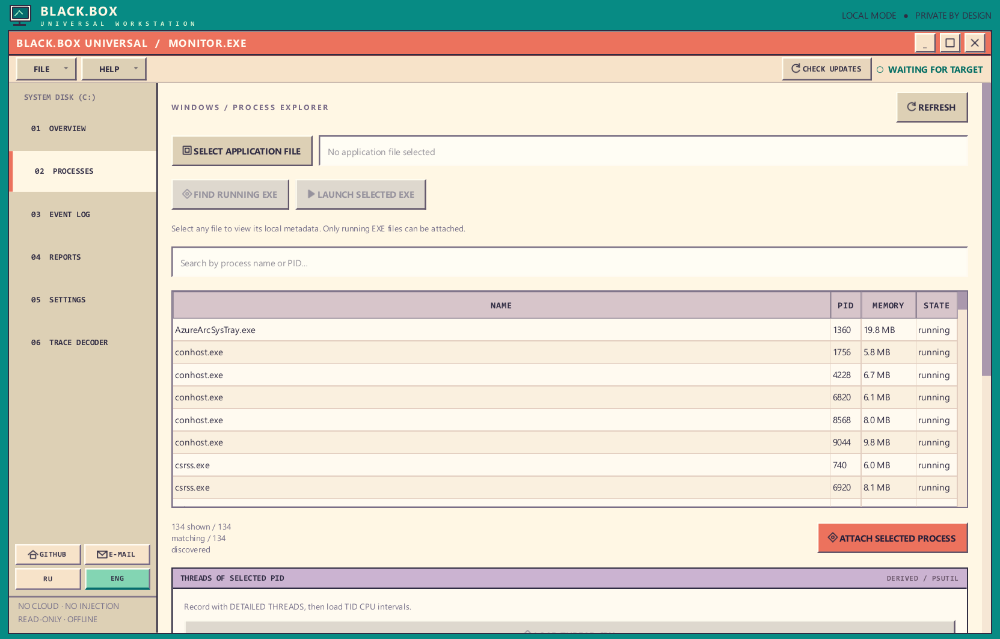
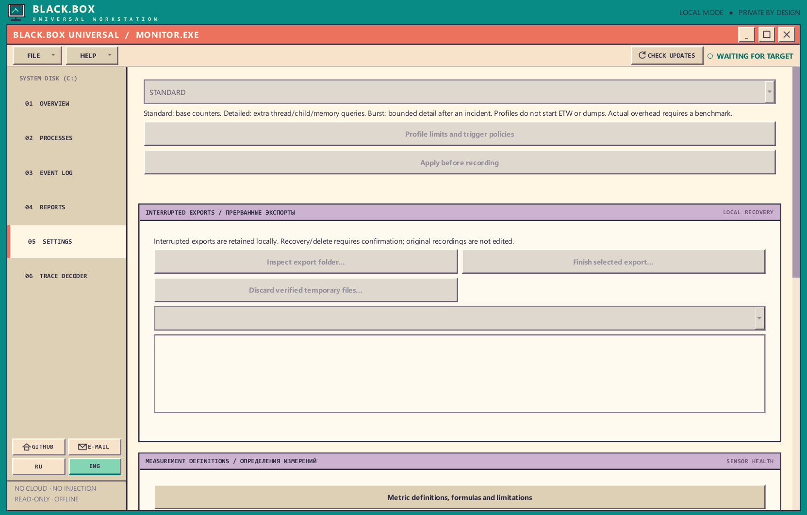
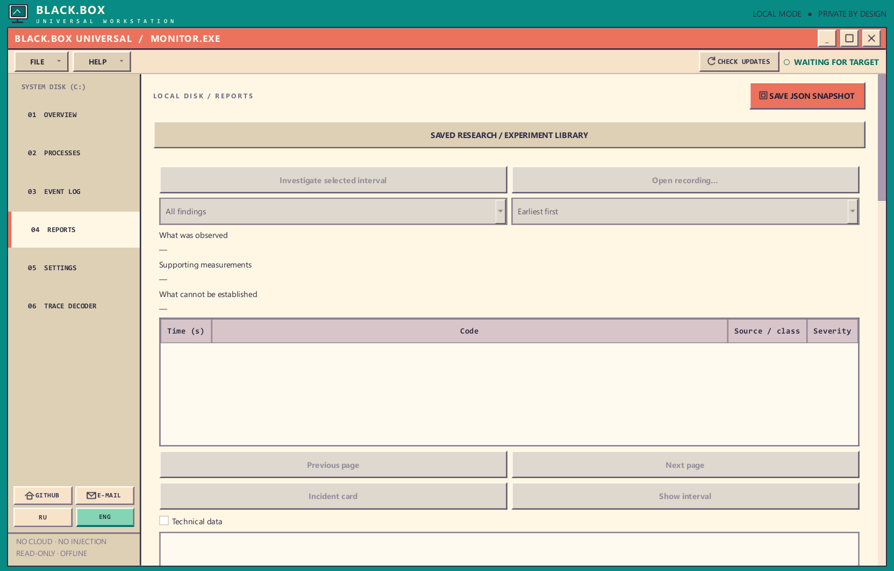
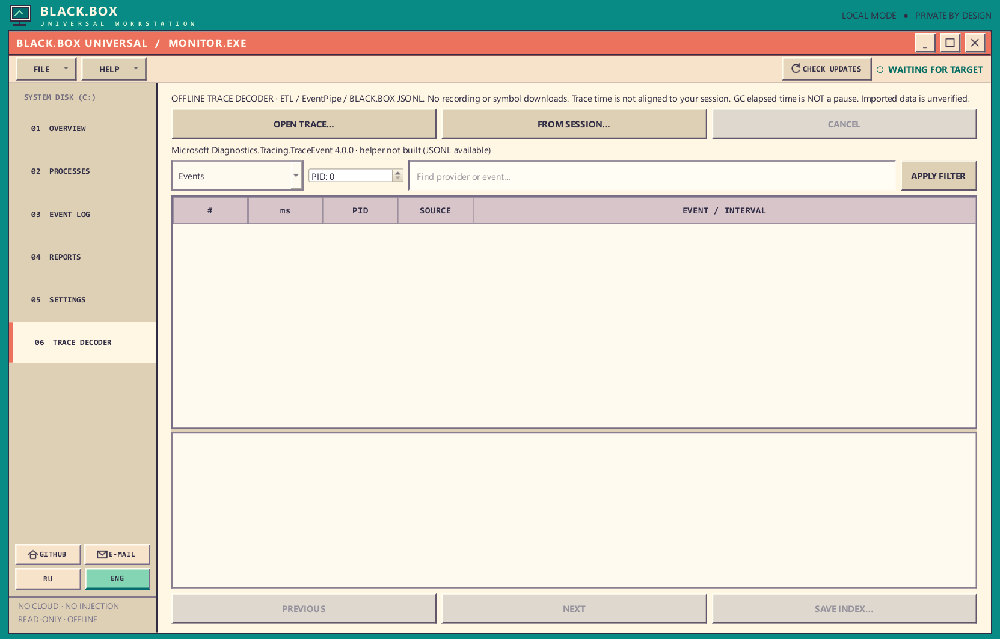
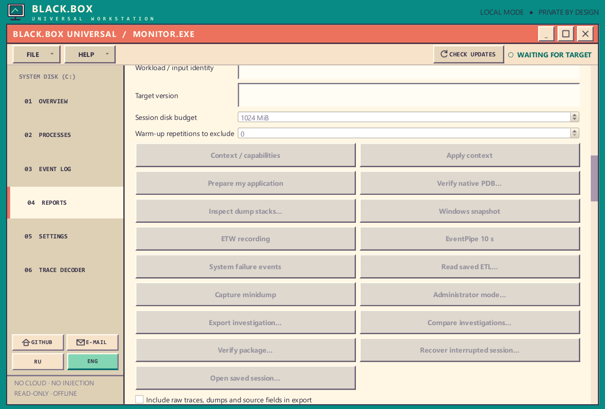

> If you found this program and it interests you, I would be very grateful if you reported any bugs you discover or suggested ways to improve it. Please send your message to **[DonJeoJesky@outlook.com](mailto:DonJeoJesky@outlook.com)**. I would truly appreciate it, because I don't have many people I know who might find this program useful (in fact, I don't have any). Even so, I hope you find in this program what you were looking for. Thank you simply for finding it.

# BLACK.BOX Universal

> **Antivirus / Windows SmartScreen notice:** Antivirus software or Microsoft Defender SmartScreen may warn about BLACK.BOX because its portable executable is unsigned and can inspect processes. **If the project interests you, you may add a narrowly scoped antivirus exception only after independently verifying and trusting the file.** Download from the [official repository Releases](https://github.com/jumonja-maker/BlackBox-Rep.-Alva-/releases), check the published ZIP SHA-256, and scan/review the download first. A warning is **not proof of a false positive**, and an exception reduces protection. Do **not** disable antivirus globally.

**A portable Windows process and application-file inspector.**

[**Download latest published Windows x64 release**](https://github.com/jumonja-maker/BlackBox-Rep.-Alva-/releases/latest) · [Releases](https://github.com/jumonja-maker/BlackBox-Rep.-Alva-/releases) · [Русская версия](README.ru.md)

[](https://github.com/jumonja-maker/BlackBox-Rep.-Alva-/actions/workflows/shell-qa.yml)
  

**Source version: v0.4.2.** Only the [official latest GitHub Release](https://github.com/jumonja-maker/BlackBox-Rep.-Alva-/releases/latest) determines what can be downloaded or installed by the updater. A source branch or CI artifact does not automatically become an update.

BLACK.BOX Universal lets you **select a running process or choose an application file**. It records operating-system measurements from a running process and saves sessions as local SQLite, JSON, and HTML files. File selection itself only reads file metadata. It does not inject code, modify the target program, or require a service, account, cloud server, subscription, or separately installed Python.

> **Important:** BLACK.BOX provides observational evidence, not proof of an application's internal root cause. High CPU, rising memory, or a process exiting do not, on their own, establish why it failed.

**MAIN-only Trace Decoder (not in the published v0.4.2 Release):** The sixth page decodes offline ETL, EventPipe and BLACK.BOX JSONL using Microsoft TraceEvent plus a local SQLite adapter. Phase 2 adds **actual CPU profiler Thread/Sample stack groups** and **GC pair statistics by CLR instance/generation**, strictly separated from arbitrary event-associated stacks. Sample counts are not CPU%, GC elapsed is not an application pause, and trace clocks are not aligned to saved sessions. [Phase 2 engineering contract](docs/TRACE_DECODER_PHASE2.md). [Phase 3 clock provenance](docs/TRACE_DECODER_PHASE3.md) exposes TraceEvent-reconstructed UTC estimates and detects suspicious timestamp offsets. [Phase 4 capture evidence](docs/TRACE_DECODER_PHASE4.md) records Windows QPC/monotonic/UTC brackets only around explicitly requested ETW/EventPipe capture, saves the captured trace SHA-256, and offers a **manual** clock-journal review. Even a matching journal and trace hash **do not establish session clock synchronization**. Download a green main CI Windows portable artifact to test; the Release ZIP remains v0.4.2 without this development feature.

**MAIN-only local PDB preflight (not in published v0.4.2):** The sixth page now offers an explicitly requested, offline PE/PDB GUID-and-Age check for a local Windows PDB. Matching files are **not** proof that the module was loaded in the trace and do **not** resolve stack symbols. No symbol server or network requests are made. [Phase 5A contract](docs/TRACE_DECODER_PHASE5.md).

**v0.4.2 desktop:** The turquoise banner and monitor icon are compact, the decorative sparkle row is gone, and the FILE/HELP toolbar uses less height. The chart, Current Session and other pages begin higher on screen; normal Windows window controls remain. CI measures the actual workspace start at full and minimum window sizes in RU/EN, with Windows offscreen DPI captures at 100–200%. This is layout-only: evidence collection and recording behavior are unchanged.

**v0.4.1 desktop:** The window starts maximized but can be restored or resized. The decorative START footer and redundant VIEW menu are removed; the telemetry chart uses the available vertical area. Privacy/security details remain in this README rather than occupying space in Settings.

## What BLACK.BOX looks like



*Overview — actual Windows CI/offscreen screenshot of the current `main` development build. The dashboard is waiting for a target; no measurement is fabricated. The published v0.4.2 release does not yet include the sixth Trace Decoder page.*

## Download and first run

1. Download the [latest Windows ZIP](https://github.com/jumonja-maker/BlackBox-Rep.-Alva-/releases/latest) and **extract it completely** to a writable directory.
2. Double-click **`BLACK.BOX-Universal.exe`**.
3. Open **Processes**. Either select a running application from the list and click **Attach**, or click **Select Application File** to choose an EXE (or another file).
4. If you chose an EXE, click **Find Running EXE** to attach to an already running instance, or **Launch Selected EXE** and explicitly approve starting the file. Then go to **Overview**, click **Start**, interact with the application, and click **Stop**.
5. In **Reports**, examine the recorded data, open the saved HTML, export a snapshot, or compare two sessions.

### Select and attach a process



*Processes — search by process name or PID, or choose an EXE file. Attaching does not start recording; use **Start** in Overview when you are ready.*

**Which EXE files are in the current MAIN development build?**

| File | Purpose |
| --- | --- |
| `BLACK.BOX-Universal.exe` | Main application. **Launch this one.** |
| `BLACK.BOX-Maintenance.exe` | Helps update or remove the portable application after the main EXE closes. Usually runs automatically. |
| `decoder/BLACK.BOX-Decoder.exe` | Optional offline ETW/EventPipe decoder, packaged with its .NET runtime in MAIN CI artifacts. The app launches it when needed; **do not launch manually**. This file is not part of the published v0.4.2 ZIP. |

Keep the entire `_internal` folder and the other extracted files. The main EXE is **not** a standalone file you can copy out of the portable folder.

## What is included?

| Tab | Capabilities |
| --- | --- |
| **Overview** | CPU/RSS metrics, graphs, Start/Stop and a live confirmation of the selected process/PID (attached, recording or stopped). |
| **Processes** | Select by name/PID **or choose an application file**. Match a running EXE by its full path, or launch a selected EXE only after explicit confirmation. |
| **Event Log** | Local observation messages; session start/stop events are persisted in SQLite. |
| **Reports** | Current snapshot, `report.json`, readable offline `report.html`, manual export and session comparison. |
| **Settings** | RU/EN interface, 1/2/5-second sampling intervals, update checks, desktop shortcut, feedback and removal. |
| **Trace Decoder — main development only** | Offline ETL/EventPipe/JSONL reading with separate CPU sample stacks and GC intervals. **Not available in the published v0.4.2 release.** |

### Settings — capture profiles and recovery controls



*Settings — select a capture profile **before recording**. Standard provides base counters, Detailed adds bounded thread/child/memory queries, and Burst adds incident-triggered detail. Disabled actions require an applicable target or state. Scroll down for export recovery and measurement definitions. Language switching (RU / ENG) is in the left sidebar; **Check Updates** is in the top toolbar. Choosing a profile does not automatically capture ETW or dumps.*

### Reports and saved observations



*Reports — inspect or export local evidence after a session; incomplete or inaccessible measurements are not silently reported as zero.*

### Development-only trace analysis



*Trace Decoder (current `main` **only**) — import an ETL, EventPipe `.nettrace`, or BLACK.BOX JSONL file offline. CPU profiler samples, event-associated stacks and GC intervals have distinct meanings. This tab is **not present** in the published v0.4.2 Release.*

Some counters are inaccessible for protected processes or unavailable on a particular system. Missing values are displayed as **unknown**, not misleading zeros. RSS describes the selected process; it is **not** the summed memory usage of a complete process tree.

### What happens when I select a file?

- **EXE:** BLACK.BOX reads file metadata and PE architecture, and can find a currently running instance **by exact executable path**, not a guessed filename. You can also choose to start the EXE yourself; starting it from BLACK.BOX requires a separate confirmation.
- **DLL, SYS, MSI, COM, BAT, CMD, PS1, PY, JAR, and other files:** display **read-only metadata** (type, size, modification time and, where possible, PE architecture). These are not stand-alone running processes and BLACK.BOX does not silently run them.
- A SHA-256 checksum is calculated **locally** for files up to 16 MiB; larger files are not hashed in the GUI. Choosing or inspecting any file never executes it.

**File inspection is not malware scanning, static code analysis, or active application debugging.** Live CPU/RSS/I/O monitoring requires a running, accessible process.

### Where does my data go?

By default, each recording is saved under:

```text
%USERPROFILE%\Documents\BLACK.BOX Universal\sessions\
└── <session-folder>\
    ├── session.sqlite3  # Measurements and lifecycle events
    ├── report.json      # Structured summary
    └── report.html      # Human-readable offline report
```

Reports can be viewed and compared without an internet connection. No process observations are uploaded automatically. **Review recorded data before sharing it**, since names and timestamps can reveal private activity.

## Updates and privacy

**Check Updates** compares the current version with the latest published [GitHub Release](https://github.com/jumonja-maker/BlackBox-Rep.-Alva-/releases). A commit pushed to `main` is **not** an update until a new version is released. If an update is available, confirm the download and installation; BLACK.BOX verifies the ZIP's size and SHA-256 and uses the Maintenance helper to replace the application after it closes.

Checking GitHub for updates at startup is **enabled by default** and can be switched off in **Settings**. Other than this check and links you deliberately open, monitoring and reports are local. Session folders under Documents are intended to survive updates and application removal.

See [Updates and maintenance](docs/UPDATES_FEEDBACK_UNINSTALL.md).

## Reliability and visual hardening in v0.3.6

- Race-safe report publication refuses overwriting existing `report.json` or `report.html` even when another writer races the check; preserves originals on failure.
- Only true observation warnings/errors appear in error summaries. User problem markers are no longer counted as errors; SQLite events are read incrementally.
- Stronger release ZIP validation rejects reserved Windows names, malformed paths, special nodes, Unicode/case aliases, collisions and preexisting staging roots.
- The portable updater and uninstaller reject Windows junction/reparse points, including ancestor folders; unreadable path metadata fails closed. Updates preserve user sessions or revert a failed replacement when possible.
- CPU plots rescale for multicore processes above 100% without clipping observed peaks.
- Automated RU/EN Qt offscreen screenshots at 100/125/150/200% scaling supplement, but do not replace, manual physical Windows DPI and update/rollback checks.

[Independent review and remaining acceptance limitations](docs/DEEP_HARDENING_REVIEW.md).

## Investigation Engine 0.1.2



*Expanded research controls in the current `main` build (not all available in the published version). Greyed-out actions need a suitable target, permission or recording state; advanced sources such as ETW/EventPipe are **explicit opt-in**, not automatic.*

- While recording, click **Mark Problem** (after at least one sample) to save a timestamp and an optional note. This is an explicitly **unverified user mark**, never OS-attested evidence of a hang.
- Stop recording. In **Reports**, click **Investigate Session** to analyze the just-completed recording or **Investigate Saved** for another local session.
- Review the new bilingual findings table and click an entry to view the measured facts and their limitations. The **Event Log** shows a separate findings table.
- Open the independent offline Investigation HTML report. The engine creates new uniquely named JSON/HTML files and does **not overwrite** the original SQLite, JSON or HTML reports.

This offline analysis uses recorded CPU, RSS, I/O and other available counters to identify suspicious *intervals*, not proven root causes. It does **not** perform ETW, wait-chain tracing, stack inspection or native hang detection. Sessions over 4096 samples require explicit approval for an analysis of just the latest 4096 samples and always disclose incomplete coverage. [Investigation Engine license](docs/vendor/investigation-0.1.2-LICENSE).

## Scope and current quality status

BLACK.BOX is **not** a PC cleaner, antivirus, automatic repair utility, crash-dump analyzer, or debugger of arbitrary third-party code. The published v0.3.6 baseline does not collect Windows ETW traces or internal call stacks. OS counters cannot prove internal program faults.

**Baseline QA for v0.3.2:** [GitHub Actions run #39872624116](https://github.com/jumonja-maker/BlackBox-Rep.-Alva-/actions/runs/39872624116) passed **new file-selection and existing process tests on Windows and Linux**, built the Windows executable, and passed frozen-EXE startup/smoke checks for commit [`6c8d9478`](https://github.com/jumonja-maker/BlackBox-Rep.-Alva-/commit/6c8d94785492e4373a80720b7812871b94856241). The newer v0.3.6 source, PE file picker, and packaged executable are subject to [current main CI](https://github.com/jumonja-maker/BlackBox-Rep.-Alva-/actions?query=branch%3Amain). Manual clean-Windows, update/rollback, antivirus and code-signing acceptance are **not established by these tests**. Distributed EXEs are currently unsigned; third-party package license notices also require final review.

## Developing from source

The project is Python-first: **Python 3.11+**, PySide6/Qt, psutil, SQLite, and the standalone `blackbox_core` package. Developers need Python; users of the portable ZIP do not.

```powershell
py -3.11 -m venv .venv
.\.venv\Scripts\Activate.ps1
python -m pip install -r requirements.txt
python -m pip install -e .
python app.py
```

To run tests and the GUI smoke check:

```powershell
python -m unittest discover -s tests -v
python app.py --smoke
```

An optional CLI is available for advanced users. The `record --output` directory must already exist:

```powershell
python -m blackbox_core list
python -m blackbox_core record --pid 1234 --output .\sessions --duration 10 --interval 1
python -m blackbox_core summary .\sessions\<session-folder>
python -m blackbox_core compare .\sessions\<first-folder> .\sessions\<second-folder>
```

It also supports `export`. The desktop GUI is the normal user interface.

### Project layout

```text
app.py                       GUI entry point and smoke test
blackbox_universal/          Qt shell, file picker, observer, updates, maintenance
src/blackbox_core/           Read-only process sampling, SQLite, reports, CLI
tests/                      Automated tests
tools/                      Windows icon creation and EXE resource verification
.github/workflows/           Windows/Linux CI and portable release packaging
docs/                       Architecture, contracts and release requirements
```

See [Architecture](docs/ARCHITECTURE.md), [Product scope](docs/PRODUCT_SCOPE.md), [QA evidence](docs/QA_EVIDENCE.md), and [Release gates](docs/RELEASE_GATES.md).

## License and feedback

The original source is available under [MIT](LICENSE). Packaged dependencies, including Qt/PySide6 and Python, retain their respective licenses; see [Licensing](docs/LICENSING.md).

To report a problem, [open an issue](https://github.com/jumonja-maker/BlackBox-Rep.-Alva-/issues) with your BLACK.BOX version, Windows version, reproduction steps, and only **non-sensitive** report excerpts. You can also send feedback to **[DonJeoJesky@outlook.com](mailto:DonJeoJesky@outlook.com)**. Please do not include sensitive data from diagnostic reports.

### Integrated diagnostics and scope

BLACK.BOX includes Standard, Detailed and incident-burst observations, persisted process/thread histories, local interval analysis and optional native Windows/WCT, ETW, EventPipe and minidump sources. Additional capture is explicitly controlled; recorded counters do not prove an internal root cause. Session files and local evidence are not uploaded automatically.

The v0.4.1 patch refines desktop layout only: it does **not** add an automatic detective, new system collectors or higher sampling overhead. Physical Windows 10/11, assistive technology, antivirus/OneDrive and the full 128-point diagnostic acceptance remain separate validations. See [implementation status](docs/BB_DI_001_IMPLEMENTATION_STATUS.md) and [research scope](docs/RESEARCH_PRODUCT_IMPLEMENTATION.md).
