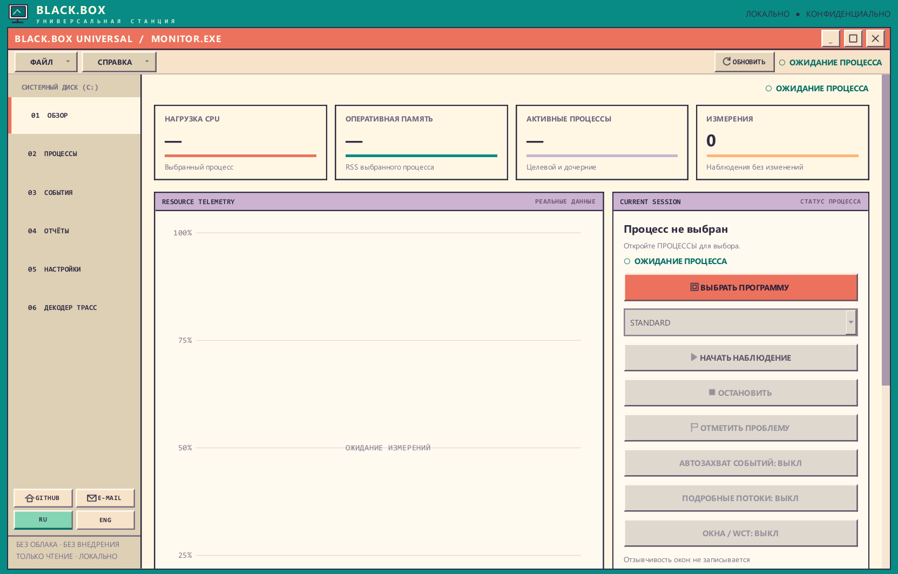

> Если вы нашли эту программу и она вам интересна, я был бы очень благодарен, если бы вы сообщили об обнаруженных ошибках или предложили, как улучшить программу. Отправьте, пожалуйста, своё сообщение сюда: **[DonJeoJesky@outlook.com](mailto:DonJeoJesky@outlook.com)**. Я был бы вам очень благодарен, потому что у меня не так много знакомых, кому могла бы пригодиться эта программа (их вообще нет). И всё-таки мне хочется, чтобы вы нашли в этой программе то, что искали. Спасибо вам за то, что вы просто её нашли.

# BLACK.BOX Universal

> **Внимание: антивирус и Windows SmartScreen.** Антивирус может ругаться на BLACK.BOX: переносимый EXE пока не подписан цифровой подписью и умеет исследовать процессы. **Если программа вас заинтересовала, вы можете добавить конкретный файл в исключения антивируса — но только после проверки и при полном доверии к нему.** Скачивайте из [официальных выпусков GitHub](https://github.com/jumonja-maker/BlackBox-Rep.-Alva-/releases), проверяйте опубликованный SHA-256 архива и предварительно сканируйте файл. Срабатывание антивируса **не означает автоматически ложную тревогу**; исключение снижает защиту. **Не отключайте антивирус целиком.**

**Портативная рабочая среда Windows: записать процесс, изучить локальные свидетельства и выполнить отдельно разрешённую диагностику.**

[**Скачать опубликованный ZIP для Windows x64**](https://github.com/jumonja-maker/BlackBox-Rep.-Alva-/releases/latest) · [Рабочий процесс специалиста](docs/USER_GUIDE_RU.md) · [English README](README.md)

[](https://github.com/jumonja-maker/BlackBox-Rep.-Alva-/actions/workflows/shell-qa.yml)
  

**Версия исходников: v0.6.1 — кандидат отдельного проверяемого выпуска. Последний опубликованный релиз — [v0.6.0](https://github.com/jumonja-maker/BlackBox-Rep.-Alva-/releases/tag/v0.6.0) от 9 ноября 2026, SHA `b922491ffeb866d24e3948a2f27a88549e5ad9d7`.** Возможности R10–R60 опубликованы в v0.6.0. Улучшения PR #49 вошли в main позднее и попадут в скачиваемый ZIP только после отдельного успешного выпуска v0.6.1. Доступная версия определяется [официальным GitHub Release](https://github.com/jumonja-maker/BlackBox-Rep.-Alva-/releases/latest), а не зелёным CI.

## Выберите вопрос для записи

| Задача | С чего начать | Что изучить и сохранить |
| --- | --- | --- |
| Воспроизвести замедление, рост памяти или всплеск I/O | Выбрать процесс, записать нагрузку и отметить нужный момент | Временную шкалу, счётчики, пропуски и находки со ссылками на источники; локальные SQLite/JSON/HTML |
| Сравнить два запуска одной нагрузки | Сохранить сопоставимые цель, профиль, интервал и условия работы | Сравнение сеансов/действий с числом повторов, разбросом и несовместимыми условиями |
| Изучить сохранённую трассу или сбой | Открыть ETL/EventPipe/JSONL в Trace Decoder либо соответствующий инструмент сохранённых источников | Отфильтрованные события, доступные стеки/символы и границы покрытия; экспорт JSON/HTML |
| Проверить диагностическую гипотезу другими данными | Открыть «Глубокое исследование» или Investigation Engine 3 внутри «Обзора» | Связи источников, частичный критический путь, гипотезы и отдельно подтверждённые шаги проверки |

CPU, RSS, I/O, ожидания и совпадения по времени — наблюдения. Сами по себе они не доказывают внутреннюю причину неисправности приложения. Неизвестные права, часы, символы и полнота данных остаются явными.

## Выбрать → записать → остановить → изучить

1. **Выбрать.** На странице **«Процессы»** найдите имя/PID, выберите нужный работающий экземпляр и подключитесь. Проверьте идентичность в **«Обзоре»**. PID вместе со временем создания отличает экземпляр; выбор файла или просмотр записанного потомка не начинает запись и не меняет живую цель.
2. **Записать.** До **«Начать наблюдение»** выберите **Standard**, **Detailed** или **Incident Burst** и проверьте интервал. Воспроизведите нагрузку. При необходимости отметьте проблему или границы действия; это заявления пользователя, а не подтверждённые сбои ОС.
3. **Остановить.** Нажмите **«Остановить наблюдение»** и проверьте статус сохранения/завершения. У записи SQLite и готовых отчётов отдельные состояния ошибки; ошибка отчёта не означает потери измерений. Сохраните показанный путь сеанса и повторяйте только неудавшуюся операцию.
4. **Изучить.** В «Обзоре» нажмите **«РЕЗУЛЬТАТ»** (подсказка **«Открыть результат записи»**) или **Ctrl+Shift+R**, когда остановленная запись готова. Это явно открывает её сохранённые данные в **«Отчётах»**; Stop оставляет текущую страницу. В «Отчётах» также открываются другие сохранённые сеансы. До чтения находок проверьте сеанс, экземпляр, интервал и покрытие, затем уточните диапазон, сравните или экспортируйте данные.

В «Отчётах» видны папка/диапазон открытого анализа и переходы **«Шкала»**, **«Находки»**, **«Библиотека»**, **«Действия / SDK»** и **«Снимок / сравнение»**. Копирование контекста анализа помещает его в локальный буфер обмена; проверьте его перед передачей. **Ctrl+1…6** переключает шесть страниц; **Ctrl+L** открывает «Процессы» и фокусирует поиск. **«Текущее наблюдение»** / JSON текущего наблюдения и **«HTML последней записи»** сохраняют указанный источник живого наблюдения/последней записи; они не экспортируют отдельно открытый сохранённый анализ. **«Последнее сравнение»** указывает две собственные папки и не меняет анализ или живую цель.

Для воспроизводимых экспериментов указывайте версию приложения, нагрузку и условия записи. Обычное наблюдение не запрашивает UAC. Профили не включают ETW, EventPipe и дампы автоматически.

[Подробное руководство](docs/USER_GUIDE_RU.md) · [English guide](docs/USER_GUIDE_EN.md) · [Границы патча рабочего процесса](docs/EXPERT_WORKFLOW_PATCH_RU.md)

## Наблюдение, исследование и вмешательство

| Область | Что означает |
| --- | --- |
| **OBSERVE** | Чтение доступных системных счётчиков выбранного процесса. Память цели не изменяется. |
| **INSPECT** | Отдельные запросы и снимки в «Глубоком исследовании». Доступ, поддержанные источники и чувствительные данные зависят от операции; снятие дампа может кратко приостановить цель. |
| **INTERVENE** | Явные отладочные действия, приостановка/возобновление потоков или изменение выбранных байтов памяти. Нужны подтверждение операции/цели и соответствующий доступ; наблюдение их не запускает. |

GUI не повышает собственные права. В исходниках R10 используется ограниченный по области и времени Diagnostic Helper; каждое вмешательство сохраняет отдельное согласие и проверку PID/времени создания. Включение прав не разрешает все последующие действия. Защита Windows может отказать в доступе. Неизвестное выполнение или очистка остаются неизвестными; откат после аварии не гарантируется. [Глубокое исследование](docs/BB_DEEP_001_RU.md) · [Границы R10](docs/R10_RU.md).

## Шесть страниц и рабочий контекст

| Страница | Назначение |
| --- | --- |
| **Обзор** | Идентичность живой цели, состояние записи, профиль, графики и явная расширенная диагностика внутри страницы |
| **Процессы** | Поиск и подключение экземпляра, метаданные файла, история записанных процессов/потоков |
| **События** | Фильтрация наблюдений и событий жизненного цикла, исходные ссылки событий |
| **Отчёты** | Текущие и сохранённые записи, выбранный интервал, анализ, сравнение и локальный экспорт |
| **Настройки** | Интервал и политика записи, восстановление, обновление и обслуживание |
| **Trace Decoder** | Офлайн-разбор ETL, EventPipe `.nettrace` и BLACK.BOX JSONL с явными фильтрами процесса/потока/времени |

Сохранённый сеанс, импортированная трасса, живая цель и запуск диагностики — разные источники. Открытие истории не разрешает действие над живым процессом. Шесть главных страниц и прежний пятистраничный embedding API сохранены.



*Исторический Windows CI/offscreen-снимок до этого патча рабочего процесса. Он показывает прежнюю оболочку, а не приёмку текущей компоновки. [Происхождение снимков](docs/screenshots/README.md).*

## Портативный комплект и локальные данные

Полностью распакуйте опубликованный ZIP в доступную для записи папку и запустите **`BLACK.BOX-Universal.exe`**. Сохраните `_internal` и все сопутствующие файлы. Портативной программе не нужны отдельный Python, учётная запись, подписка или обязательный облачный сервис.

| Исполняемый файл | Назначение |
| --- | --- |
| `BLACK.BOX-Universal.exe` | Основное приложение |
| `BLACK.BOX-Maintenance.exe` | Помощник обновления/удаления, обычно запускаемый приложением |
| `decoder/BLACK.BOX-Decoder.exe` | Автономный офлайн-декодер TraceEvent со своим runtime, запускаемый при необходимости |

Для EXE читаются метаданные и можно найти работающий экземпляр по полному пути. Запуск выбранного EXE требует отдельного подтверждения. Остальные файлы дают метаданные; выбор файла ничего не исполняет. SHA-256 вычисляется локально для файлов до 16 МиБ. Это не антивирусная проверка и не статический анализ кода.

Папка записи по умолчанию:

```text
%USERPROFILE%\Documents\BLACK.BOX Universal\sessions\
└── <session-folder>\
    ├── session.sqlite3  # Измерения и события жизненного цикла
    ├── report.json      # Структурированный итог
    └── report.html      # Офлайн-отчёт
```

У дополнительных захватов и анализов свои файлы и состояния. Экспорт для передачи создаёт отдельную копию с редактированием известных чувствительных полей; оригиналы остаются локально. Память/дампы и raw traces требуют отдельного включения. Редактирование известных полей не распознаёт любой секрет в свободном тексте: проверяйте экспорт перед передачей. Контрольная сумма подтверждает байты, а не доверенное авторство. Наблюдения не отправляются автоматически.

**«Проверить обновления»** использует опубликованные GitHub Releases, проверяет размер/SHA-256 ZIP и вызывает Maintenance после закрытия приложения. Проверка при старте включена по умолчанию и отключается в «Настройках». Сеансы в Documents должны сохраняться при обновлении/удалении. [Обновление, обратная связь и удаление](docs/UPDATES_FEEDBACK_UNINSTALL.md).

## Подробные материалы и история

Открывайте после выбора нужных источников:

- [Глубокое исследование: операции и границы](docs/BB_DEEP_001_RU.md) · [Investigation Engine 3: граф и ручная проверка](docs/BB_INV_003_RU.md)
- [Завершение Trace Decoder и ограничения](docs/TRACE_DECODER_COMPLETION_PATCH.md) · [Нативные CPU-выборки и фильтры](docs/TRACE_DECODER_PHASE5_PACKET2.md) · [Контракт модулей/PDB](docs/TRACE_DECODER_PHASE5_PATCH.md)
- [R10: админ-сеанс](docs/R10_RU.md) · [R20: происхождение данных](docs/BB_WAVE_02_R20_RU.md) · [R30: ожидания/I/O](docs/BB_WAVE_02_R30_RU.md) · [R40: данные сбоя](docs/BB_WAVE_02_R40_RU.md) · [R50: инциденты/сравнение](docs/R50_RU.md) · [R60: конструктор цепочек](docs/R60_CHAIN_BUILDER_RU.md). R10–R60 уже входят в опубликованную v0.6.0; улучшения экспертного рабочего процесса PR #49 относятся к кандидату v0.6.1.
- [Добровольная инструментализация своей программы / SDK](docs/SDK_GUIDE.md): пример добавляется в собственные исходники с пересборкой; внешнее наблюдение само по себе не открывает внутренние этапы приложения.
- История опубликованных версий: [v0.6.0](docs/RELEASE_v0.6.0.md), [v0.5.4](docs/RELEASE_v0.5.4.md), [v0.5.3](docs/RELEASE_v0.5.3.md), [v0.5.2](docs/RELEASE_v0.5.2.md), [v0.5.1](docs/RELEASE_v0.5.1.md), [v0.5.0](docs/RELEASE_v0.5.0.md). Документ [v0.5.5](docs/RELEASE_v0.5.5.md) исторический: v0.5.5 не публиковалась. [v0.6.1](docs/RELEASE_v0.6.1.md) — кандидат до отдельного публичного тега.
- [Архитектура](docs/ARCHITECTURE.md) · [Границы продукта](docs/PRODUCT_SCOPE.md) · [Свидетельства QA](docs/QA_EVIDENCE.md) · [Условия выпуска](docs/RELEASE_GATES.md) · [Исторический список требований](docs/BB_DI_001_IMPLEMENTATION_STATUS.md)

Офлайн-анализ сеанса выделяет подозрительные записанные интервалы и создаёт отдельные JSON/HTML. Сам он не собирает недостающие ETW/стеки. Investigation Engine 3 связывает поддержанные сохранённые источники; `BLOCKED` не доказывает владельца блокировки, гипотезы требуют проверки. Число выборок трассы — не CPU%; GC elapsed — не stop-the-world пауза. Импорт остаётся непроверенным; связь часов трассы/сеанса устанавливается для конкретных входных данных.

Проверки hosted Windows/Linux, native и portable относятся к указанным сценариям и точным исходным коммитам. Они не подтверждают физическую приёмку Windows 10/11, интерактивный Secure Desktop UAC, доступность с ассистивными средствами, репутацию антивируса или любую длительность работы. Исторический PR #17 и его 128 требований относятся к прежнему этапу, а не к текущему статусу приёмки патча. Текущие результаты определяются CI точного коммита и соответствующим отчётом патча. EXE не подписаны; тексты лицензий не заменяют полного юридического аудита распространения.

## Исходники и CLI

Используются Python 3.11+, PySide6/Qt, psutil, SQLite и `blackbox_core`. Для этого патча действует [AGENTS.md](AGENTS.md): запуск приложения/тестов/сборок разрешён только на GitHub-hosted runners; локально разрешены чтение и правки исходников. Обычная настольная поставка — портативный ZIP.

Необязательный CLI поддерживает `list`, `record`, `summary`, `compare` и `export`. Папка `record --output` должна существовать заранее:

```powershell
python -m blackbox_core list
python -m blackbox_core record --pid 1234 --output .\sessions --duration 10 --interval 1
python -m blackbox_core summary .\sessions\<папка-сеанса>
python -m blackbox_core compare .\sessions\<первый-сеанс> .\sessions\<второй-сеанс>
```

## Лицензия и обратная связь

Оригинальный код: [MIT](LICENSE). Встроенные зависимости сохраняют собственные условия; [лицензии](docs/LICENSING.md).

[Создайте Issue](https://github.com/jumonja-maker/BlackBox-Rep.-Alva-/issues) или напишите на **[DonJeoJesky@outlook.com](mailto:DonJeoJesky@outlook.com)**. Укажите версии BLACK.BOX/Windows и шаги воспроизведения. Прикладывайте только несекретные выдержки отчёта.
