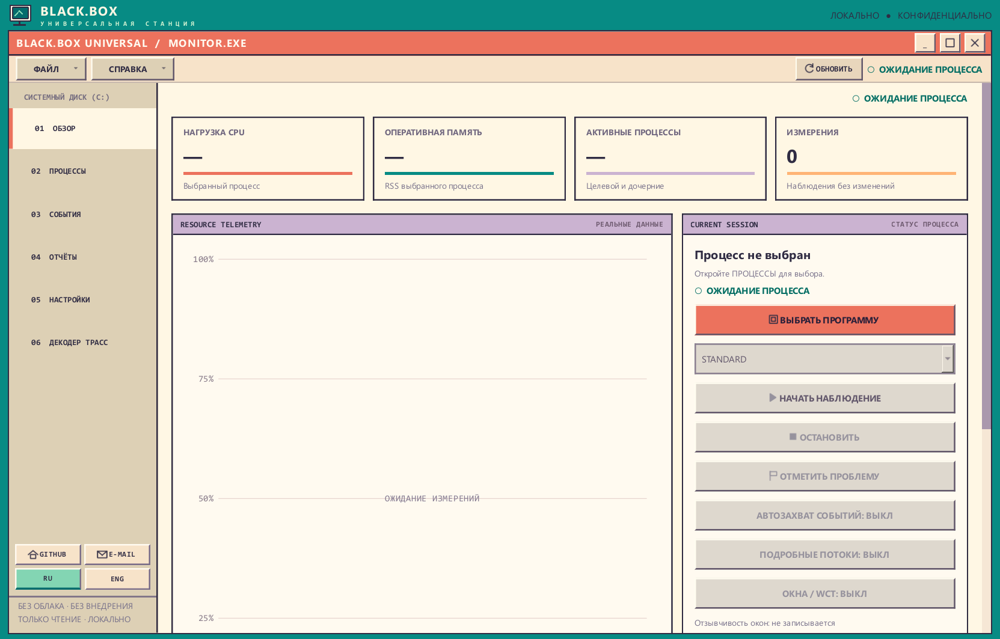
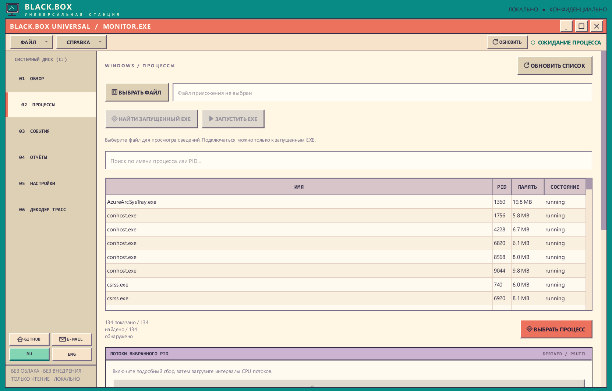
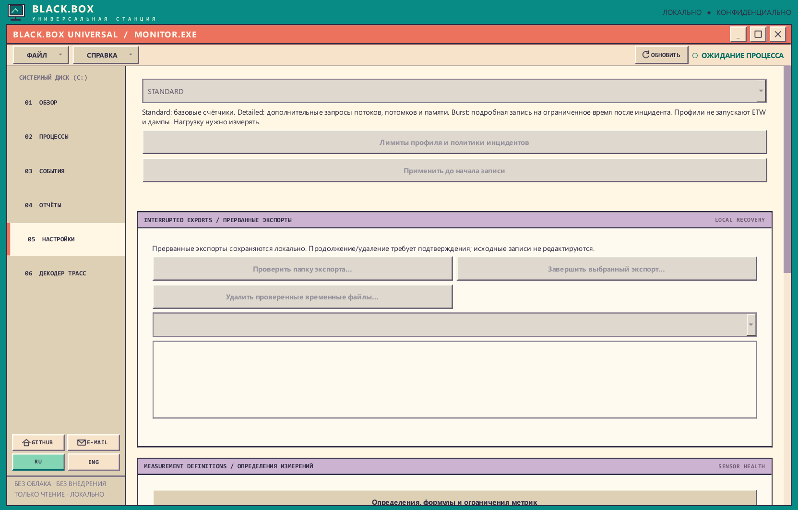
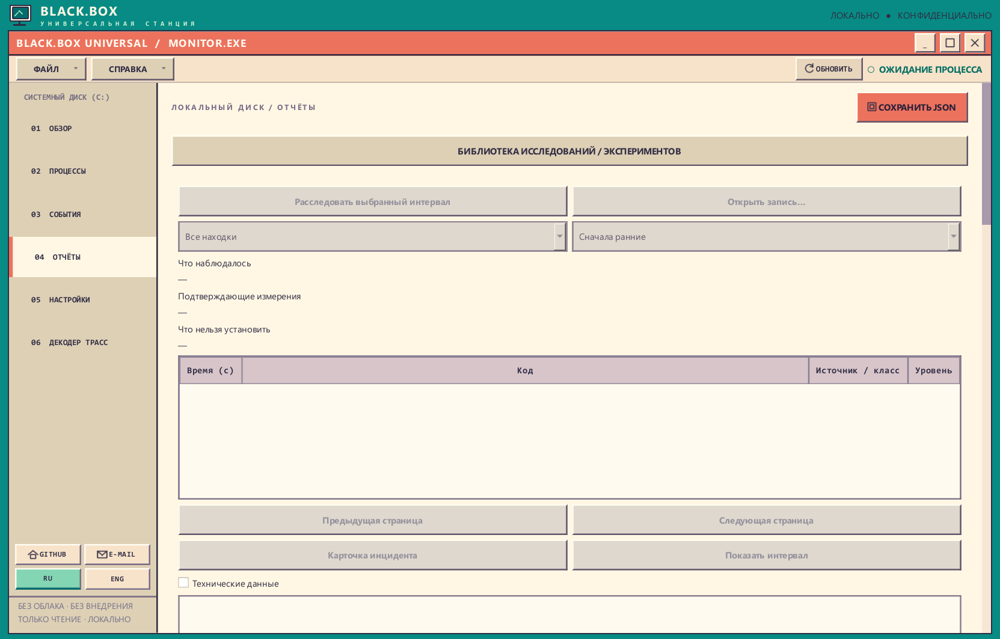
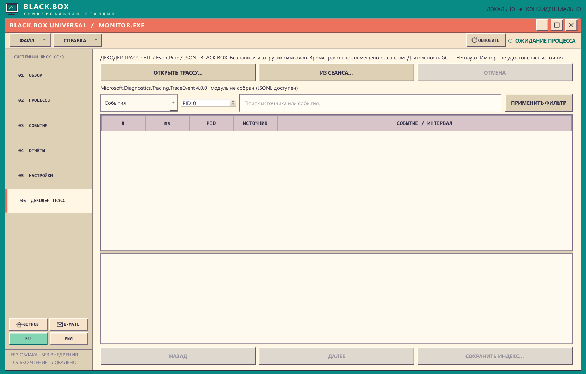
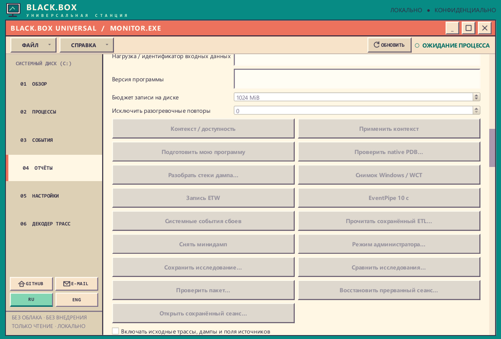

> Если вы нашли эту программу и она вам интересна, я был бы очень благодарен, если бы вы сообщили об обнаруженных ошибках или предложили, как улучшить программу. Отправьте, пожалуйста, своё сообщение сюда: **[DonJeoJesky@outlook.com](mailto:DonJeoJesky@outlook.com)**. Я был бы вам очень благодарен, потому что у меня не так много знакомых, кому могла бы пригодиться эта программа (их вообще нет). И всё-таки мне хочется, чтобы вы нашли в этой программе то, что искали. Спасибо вам за то, что вы просто её нашли.

# BLACK.BOX Universal

> **Внимание: антивирус и Windows SmartScreen.** Антивирус может ругаться на BLACK.BOX: переносимый EXE пока не подписан цифровой подписью и умеет исследовать процессы. **Если программа вас заинтересовала, вы можете добавить конкретный файл в исключения антивируса — но только после проверки и при полном доверии к нему.** Скачивайте из [официальных выпусков GitHub](https://github.com/jumonja-maker/BlackBox-Rep.-Alva-/releases), проверяйте опубликованный SHA-256 архива и предварительно сканируйте файл. Срабатывание антивируса **не означает автоматически ложную тревогу**; исключение снижает защиту. **Не отключайте антивирус целиком.**

**Портативный инструмент наблюдения, глубокого исследования и управляемых диагностических действий в Windows.**

[**Скачать последний опубликованный релиз Windows x64**](https://github.com/jumonja-maker/BlackBox-Rep.-Alva-/releases/latest) · [Все версии](https://github.com/jumonja-maker/BlackBox-Rep.-Alva-/releases) · [English README](README.md)

[](https://github.com/jumonja-maker/BlackBox-Rep.-Alva-/actions/workflows/shell-qa.yml)
  

**Версия исходного кода: v0.5.4.** Доступная для скачивания версия определяется только [официальным GitHub Release](https://github.com/jumonja-maker/BlackBox-Rep.-Alva-/releases/latest); зелёный CI сам по себе не публикует обновление.

BLACK.BOX Universal позволяет **выбрать запущенный процесс либо указать файл приложения**. Режим OBSERVE измеряет системные показатели и сохраняет SQLite, JSON и HTML, не изменяя исследуемую программу. Выбор файла сам по себе ничего не запускает. В отдельном патче BB-DEEP-001 явные действия INSPECT и INTERVENE позволяют снимать состояние, приостанавливать и отлаживать процесс, менять выбранные байты после подтверждения. Обычный sampler эти действия не запускает. Программа не требует регистрации, подписки, собственного сервера, фоновой службы или отдельной установки Python.

> **Важно:** собранные измерения — это наблюдения, а не доказательство внутренней причины сбоя приложения. Высокая нагрузка CPU, увеличение памяти или завершение процесса сами по себе не объясняют, почему программа работает неправильно.

**Investigation Engine 3 — v0.5.4:** «Обзор → Глубокое исследование → ИССЛЕДОВАТЬ ПРОБЛЕМУ» связывает сохранённые события, частичные интервалы потоков и проверяемые гипотезы. Действия ДО/ДЕЙСТВИЕ/ПОСЛЕ подтверждаются отдельно; неизвестные часы, идентификаторы и источники не выдаются за известные. [Руководство](docs/BB_INV_003_RU.md) · [English guide](docs/BB_INV_003_EN.md) · [ТЗ](docs/specifications/BB-INV-003.md).

**BB-DEEP-001 — доступен с v0.5.3:** раскрываемый блок **«Глубокое исследование»** находится внутри «Обзора» и содержит процессы, модули, потоки, дескрипторы, память, сеть, диск, отладку и историю действий. Проверка доступа относится к конкретной операции; при необходимости предлагается стандартный UAC для ограниченной сессии диагностического helper, без повышения прав всего GUI. Память и дампы не включаются в обычную передачу данных. Идентификатор экземпляра из исторической трассы не подменяет время создания текущего процесса. [Инструкция и границы поддержки](docs/BB_DEEP_001_RU.md) · [English guide](docs/BB_DEEP_001.md) · [исходное ТЗ](docs/specifications/BB-DEEP-001.md). Выпуск v0.5.3 проверен через GitHub-hosted CI на точном SHA.

**BB-DEEP-001 — опубликован в v0.5.3:** расширенная диагностика процессов, управляемые отладочные и memory-действия, отдельный Diagnostic Helper. [Описание v0.5.3](docs/RELEASE_v0.5.3.md).

**Завершение декодера в исходниках v0.5.2:** Проверяемая локальная временная связь с сеансом и явная погрешность, off-CPU/ReadyThread ETW, строки исходников/inline/OMAP native PDB, ограничения и восстановление импорта. Связь часов не удостоверяет происхождение трассы; события планировщика не доказывают владельца блокировки; неизвестные символы остаются неизвестными. [Границы и приёмка](docs/TRACE_DECODER_COMPLETION_PATCH.md) · [описание v0.5.2](docs/RELEASE_v0.5.2.md). Устанавливаемую версию определяет только опубликованный GitHub Release, а не коммит исходников.

**Декодер v0.5.0:** Шестая вкладка офлайн-разбора ETL, EventPipe и JSONL BLACK.BOX через встроенный автономный Microsoft TraceEvent. Добавлены события, интервалы GC, проверка часов записи, каталог модулей, локальные PE/PDB и производные имена функций, отдельные деревья CPU-выборок .NET и нативного ETW. Можно явно выбрать PID, экземпляр процесса, поток и интервал времени, сохранить JSON либо HTML/SVG flame graph без скриптов. Автоматической записи и скачивания символов нет. Число выборок — не процент CPU, GC elapsed — не пауза, синхронизация с сеансом остаётся **NOT_ESTABLISHED**. Подробности: [состав и ограничения выпуска](docs/RELEASE_v0.5.0.md), [контракт модулей/PDB](docs/TRACE_DECODER_PHASE5_PATCH.md), [нативные CPU-выборки и фильтры](docs/TRACE_DECODER_PHASE5_PACKET2.md). Публикация разрешена только после Windows/Linux/portable-проверок и испытаний настоящих трасс на точном коммите; исходная ветка сама по себе не обновление.

**Интерфейс v0.4.2:** Верхняя бирюзовая шапка и логотип компактнее, декоративная строка со звёздочками удалена, меню FILE/HELP стало ниже. График, «Текущий сеанс» и остальные страницы действительно поднялись вверх. Обычные кнопки Windows сохранены. CI проверяет реальную координату начала рабочей области при двух размерах окна и языках RU/EN, а Windows выполняет DPI-снимки при 100–200%. Сбор измерений и доказательств не изменён.

**Интерфейс v0.4.1:** окно открывается развёрнутым с обычными кнопками Windows и возможностью менять размер. Декоративная нижняя полоса START и лишнее меню VIEW удалены; график использует свободную высоту. Пояснения о конфиденциальности остаются в README, а не занимают место в «Настройках».

**Исправления аудита v0.5.1:** независимость записи от индекса, очистка только экспортных копий, Stop и повтор анализа, полнота находок и согласие на заметки, CSV и Unicode-поиск профилей. Включены исправления PR #25 и независимые регрессии встроенных путей/схем. [Состав и ограничения выпуска](docs/RELEASE_v0.5.1.md). Исходная ветка не является опубликованным обновлением до прохождения release gate.

## Как выглядит BLACK.BOX



*Обзор — настоящий снимок из Windows CI/offscreen, предыдущая версия разработки `main`. Программа ожидает выбор процесса; измерения не подставлены искусственно. В старой v0.4.2 декодера нет; он добавлен в v0.5.0. Снимки сделаны до завершения элементов управления декодером v0.5.0.*

## Скачивание и первый запуск

1. Скачай [последний Windows ZIP](https://github.com/jumonja-maker/BlackBox-Rep.-Alva-/releases/latest) и **полностью распакуй** архив в доступную для записи папку.
2. Запусти **`BLACK.BOX-Universal.exe`** двойным щелчком.
3. Открой **«Процессы»**. Можно выбрать работающую программу из списка и нажать **Attach**, либо выбрать **«Выбрать файл»** и указать EXE или другой файл.
4. Для EXE нажми **«Найти запущенный EXE»** или **«Запустить EXE»** (с отдельным подтверждением). После подключения перейди в **«Обзор»**, нажми **Start**, поработай в приложении и нажми **Stop**.
5. Открой **«Отчёты»**: просмотри результаты, открой HTML, экспортируй снимок либо сравни два сеанса.

### Выбрать и подключить процесс



*Процессы — ищите по имени или PID либо выберите EXE. Подключение не начинает запись: когда готовы, нажмите **Start** на вкладке «Обзор».*

**Какие EXE входят в v0.5.0?**

| Файл | Назначение |
| --- | --- |
| `BLACK.BOX-Universal.exe` | Основная программа. **Запускай этот файл.** |
| `BLACK.BOX-Maintenance.exe` | Служебный компонент для обновления или удаления приложения после его закрытия. Обычно запускается автоматически. |
| `decoder/BLACK.BOX-Decoder.exe` | Автономный декодер ETW/EventPipe со своей .NET-средой в поставке v0.5.0. Запускается самим BLACK.BOX, **не запускать вручную**. Входит с v0.5.0; в старой v0.4.2 отсутствует. |

Не удаляй `_internal` и остальные файлы из распакованной папки. Основной EXE нельзя переносить отдельно от его библиотек.

## Что умеет BLACK.BOX

| Вкладка | Возможности |
| --- | --- |
| **Обзор** | CPU, RSS, графики, Start/Stop и идентичность выбранного процесса. Патч BB-DEEP-001 добавляет свёрнутый блок глубокого исследования с явными диагностическими действиями. |
| **Процессы** | Поиск по имени/PID или **выбор файла программы**, поиск работающего EXE по точному пути, запуск EXE только по явному подтверждению. |
| **Журнал событий** | Сообщения наблюдателя; события начала и остановки сеанса сохраняются также в SQLite. |
| **Отчёты** | Текущие измерения, `report.json`, читаемый без сети `report.html`, экспорт и сравнение сеансов. |
| **Настройки** | Русский/английский интерфейс, интервалы 1/2/5 секунд, обновления, ярлык, обратная связь, удаление. |
| **Декодер трасс — в выпусках с v0.5.0** | Офлайн-анализ ETL/EventPipe/JSONL с разделением стеков CPU-профилировщика и GC. Включён в опубликованную v0.5.1; более старая v0.4.2 этой вкладки не содержит. |

### Настройки: профили сбора данных и восстановление экспортов



*Настройки — профиль выбирается **перед записью**. Standard собирает базовые счётчики, Detailed добавляет ограниченный опрос потоков, дочерних процессов и памяти, Burst — дополнительную детализацию по инцидентам. Неактивные кнопки требуют подходящего состояния или выбранного процесса. Прокрутите ниже к восстановлению экспортов и описаниям измерений. Переключение **RU / ENG** находится слева, **«Проверить обновления»** — сверху. Выбор профиля сам по себе не включает ETW или создание дампов.*

### Отчёты и сохранённые наблюдения



*Отчёты — чтение и экспорт локальных результатов после записи. Недоступные показатели не подменяются нулями.*

### Декодер трасс — опубликован начиная с v0.5.0



*Декодер трасс (опубликован с v0.5.0, сохранён в v0.5.1) — офлайн-импорт ETL, EventPipe `.nettrace` и JSONL BLACK.BOX. Выборки CPU, стеки других событий и интервалы GC имеют разный смысл. Более старая v0.4.2 этой вкладки не содержит.*

Некоторые показатели недоступны для защищённых процессов или в отдельных условиях Windows. Отсутствующие измерения отображаются как **«нет данных»**, а не как ноль. RSS — это память **выбранного процесса**, а не суммарное потребление всего дерева дочерних процессов.

### Какие форматы файлов поддерживаются?

- **EXE:** отображаются размер, дата изменения, архитектура PE и другие сведения. BLACK.BOX может найти процесс, запущенный **именно из этого пути**, или запустить EXE после отдельного подтверждения пользователя.
- **DLL, SYS, MSI, COM, BAT, CMD, PS1, PY, JAR и другие файлы:** доступен **только просмотр сведений о файле**. Это не отдельные запущенные процессы; BLACK.BOX не выполняет такие файлы автоматически.
- Для файлов размером до 16 МиБ локально вычисляется SHA-256. Для больших файлов хеш в интерфейсе не вычисляется. Сам выбор файла не приводит к запуску.

**Просмотр файла не заменяет антивирусную проверку или анализ внутреннего кода.** Для мониторинга CPU/RAM/I/O необходим работающий доступный процесс.

### Где лежат сохранённые данные?

По умолчанию программа создаёт отдельную папку сеанса:

```text
%USERPROFILE%\Documents\BLACK.BOX Universal\sessions\
└── <папка-сеанса>\
    ├── session.sqlite3  # Измерения и события
    ├── report.json      # Структурированный отчёт
    └── report.html      # Отчёт для просмотра в браузере
```

Открывать HTML и сравнивать сохранённые сеансы можно **без интернета**. BLACK.BOX не загружает собранные данные на сервер автоматически. Перед отправкой отчёта другому человеку проверь его содержимое: названия процессов и время работы могут быть личной информацией.

## Обновление, удаление и конфиденциальность

Кнопка **«Проверить обновления»** обращается к [GitHub Releases](https://github.com/jumonja-maker/BlackBox-Rep.-Alva-/releases). Новый коммит в `main` **не** является обновлением, пока не опубликован выпуск с более высокой версией. Если выпуск найден, подтверди загрузку и установку: программа проверит размер ZIP и SHA-256, закроется и передаст замену файлов служебному Maintenance EXE.

Проверка GitHub при запуске **включена по умолчанию**; её можно отключить в **«Настройках»**. Наблюдение и отчёты остаются локальными. Сеансы из «Документов» должны сохраняться при обновлении и удалении приложения.

Подробнее: [Обновление и обслуживание](docs/UPDATES_FEEDBACK_UNINSTALL.md).

## Надёжность и интерфейс в версии 0.3.6

- Публикация `report.json` и `report.html` больше не перезаписывает чужие файлы при конкурентной записи; при ошибке откатываются созданные этим сеансом результаты.
- В отчёте учитываются только настоящие ошибки наблюдения; пользовательские пометки ошибок не создают. Чтение журнала SQLite не требует загрузки всех событий в память.
- Проверка ZIP для обновлений отклоняет дополнительные опасные Windows-имена, коллизии путей, специальные файлы и существующие каталоги распаковки.
- Обновление и удаление блокируются, если путь установки или его родитель содержит junction/reparse point или Windows отказала в проверке пути. Проверяется откат обновления и сохранность прежних сеансов при конфликте.
- График CPU отображает значения выше 100% для многоядерных процессов.
- CI создаёт снимки 5 экранов в RU/EN при масштабах 100/125/150/200%. Это **не заменяет** ручную проверку на настоящем дисплее и проверку обновления/удаления на пользовательской Windows.

[Независимое ревью и границы проверки](docs/DEEP_HARDENING_REVIEW.md).

## Investigation Engine 0.1.2 — исследование сеансов



*Расширенные действия исследования в текущем `main` (часть отсутствует в опубликованном выпуске). Серые кнопки требуют выбранного процесса, разрешений или подходящего этапа записи. ETW/EventPipe включаются **явно**, а не автоматически.*

- Во время наблюдения нажми **«Отметить проблему»** (после первого измерения). Сохраняется время и необязательное пояснение. Это **пометка пользователя**, а не доказанное зависание Windows.
- Останови запись и открой **«Отчёты»**: **«Исследовать сеанс»** анализирует текущий завершённый сеанс, **«Исследовать сохранённый»** — другую папку сеанса.
- Изучай таблицу найденных интервалов; выбранная строка раскрывает измеренные факты и ограничения выводов. В разделе «События» есть отдельная таблица находок.
- **«Открыть HTML расследования»** показывает офлайн-отчёт. Движок создаёт отдельные JSON и HTML, не изменяя существующие `session.sqlite3`, `report.json` и `report.html`.

По реальным измерениям ищутся периоды повышенного CPU, подозрительный рост памяти, высокие скорости I/O, пропуски и сбросы счётчиков. **Причина сбоя не объявляется доказанной.** Для сеанса с более чем 4096 измерениями предлагается анализ только последних 4096 с предупреждением о неполном охвате. Сам этот офлайн-движок не снимает ETW, стеки и ожидания; соответствующие операции находятся в отдельных инструментах записи, Trace Decoder и патче Deep Inspection. [Лицензия движка](docs/vendor/investigation-0.1.2-LICENSE).

## Чего программа не делает

BLACK.BOX **не** является очистителем Windows, антивирусом или автоматическим ремонтником. Патч BB-DEEP-001 добавляет действия Windows Debug API и ограниченный локальный просмотр структуры minidump и выбранных байтов; полный разбор стека из дампа, managed heap, обход защиты и гарантированный откат после аварии не заявлены. Доступ определяет Windows. CPU/RAM/I/O, причина ожидания и успешное диагностическое действие сами по себе не доказывают внутреннюю неисправность программы.

### Насколько проверена версия 0.3.6?

PR #16 проверен на Windows (148 тестов) и Linux (146 PASS + 2 SKIP); Windows EXE smoke успешен. Финальный релиз v0.3.6 дополнительно проверяется отдельным CI для коммита `main`. Достоверный статус смотри в [GitHub Actions](https://github.com/jumonja-maker/BlackBox-Rep.-Alva-/actions?query=branch%3Amain). Физические тесты обновления/удаления и читаемости интерфейса при разных DPI остаются открытыми.

Эти проверки **не заменяют** ручные испытания на обычной Windows: установку обновления и откат, совместимость с антивирусами, репутацию неподписанного EXE и аудит лицензионных уведомлений. Исполняемые файлы пока не имеют цифровой подписи.

## Разработка из исходников

Проект использует **Python 3.11+**, PySide6/Qt, psutil, SQLite и самостоятельное ядро `blackbox_core`. Команды ниже нужны **разработчикам**; обычному пользователю достаточно ZIP и EXE.

```powershell
py -3.11 -m venv .venv
.\.venv\Scripts\Activate.ps1
python -m pip install -r requirements.txt
python -m pip install -e .
python app.py
```

В BB-DEEP-001 все автоматизированные тесты, контролируемые нативные нагрузки, проверки portable EXE и длительный прогон выполняются исключительно на GitHub-hosted runners. Порядок описан в [инструкции патча](docs/BB_DEEP_001_RU.md). Обязательные испытания не запускаются на пользовательском ПК; hosted job не подтверждает реальный интерактивный UAC Secure Desktop или физическую приёмку Windows 10/11.

Есть дополнительный CLI. Для команды `record` папка `--output` должна существовать заранее:

```powershell
python -m blackbox_core list
python -m blackbox_core record --pid 1234 --output .\sessions --duration 10 --interval 1
python -m blackbox_core summary .\sessions\<папка-сеанса>
python -m blackbox_core compare .\sessions\<первый-сеанс> .\sessions\<второй-сеанс>
```

Также поддерживается `export`. Для обычного использования командная строка не требуется.

### Структура проекта

```text
app.py                       Запуск GUI и smoke-проверка
blackbox_universal/          Qt-интерфейс, выбор файлов, монитор, обновления
src/blackbox_core/           Измерения, SQLite, контракты, отчёты, CLI
tests/                      Автоматические тесты
tools/                      Значки Windows и проверка ресурсов EXE
.github/workflows/           Windows/Linux CI и выпуск портативного ZIP
docs/                       Архитектура, ограничения, контроль качества
```

Документация: [Архитектура](docs/ARCHITECTURE.md) · [Границы возможностей](docs/PRODUCT_SCOPE.md) · [QA](docs/QA_EVIDENCE.md) · [Условия выпуска](docs/RELEASE_GATES.md).

## Лицензия и обратная связь

Оригинальный исходный код распространяется по [MIT](LICENSE). У встроенных библиотек, включая Qt/PySide6 и Python, есть собственные лицензионные условия — см. [Лицензии](docs/LICENSING.md).

Если нашёл ошибку, [создай GitHub Issue](https://github.com/jumonja-maker/BlackBox-Rep.-Alva-/issues) или напиши на **[DonJeoJesky@outlook.com](mailto:DonJeoJesky@outlook.com)**. Укажи версию BLACK.BOX, версию Windows и шаги воспроизведения. **Не отправляй конфиденциальные данные из отчётов.**

### Диагностика и границы возможностей

BLACK.BOX поддерживает Standard, Detailed, Incident Burst, сохранённую историю процессов и потоков, локальный анализ интервалов и дополнительные источники Windows/WCT, ETW, EventPipe и минидампы по отдельному включению. Внешние счётчики не доказывают внутреннюю причину сбоя. Сеансы и доказательства не отправляются автоматически в сеть.

Патч v0.4.1 изменяет **только компоновку интерфейса**: автоматический детектив, новые системные датчики и более интенсивный сбор данных сюда не добавлены. Физическая приёмка Windows 10/11, доступности, антивируса/OneDrive и полного списка из 128 требований остаётся отдельной работой. Подробности: [статус реализации](docs/BB_DI_001_IMPLEMENTATION_STATUS.md), [границы исследования](docs/RESEARCH_PRODUCT_IMPLEMENTATION.md).
